# Experiments

*Last updated: November 2026. Unless stated otherwise: 2025, 20 members, native EnKF, operational setup apart from the one thing each experiment changes.*

!!! abstract "In short"
    Every experiment we ran, what it asked, and what came of it. Daily assimilation, seiche filtering and profile data pay off. Making σ more refined makes the filter better calibrated, not more accurate. Surface-only assimilation damages the layers below. Extra spread from model parameters helps a little at daily steps, but only at amplitudes we cannot defend; at longer steps it pays off. Assimilation leaves the model's natural variability intact.

    The more recent work is promising: oxygen can be assimilated together with temperature, with large gains where the profiler covers the column; centring the forcing ensemble removes a systematic windiness of the members; and learning the observation and model errors online makes the ensemble honest. Over 7-day forecasts, a more realistic wind perturbation (lake wind, slow wind noise) pays off where it does not in daily assimilation. Deep mixing remains open.

✅ Operational · (✅) Positive, potentially to be adopted · ⚙️ Optional · ❌ Tested, not adopted · 🔬 Open

| Experiment | Question | Outcome | Status |
|---|---|---|---|
| [Assimilation frequency](#frequency) | Daily, or less often? | Daily is best (Upperlugano pooled RMSE): −26 % vs −23 % (3 days) and −20 % (7 days) | ✅ daily |
| [Observation filtering](#filtering) | Does seiche filtering help? | Yes: without it, hard to see gains at the thermocline | ✅ |
| [Surface-only](#surface-only) | Is a surface station enough? | No. Helps the surface, damages 10–35 m against CTD | ❌ |
| [Depth-resolved σ](#sigma-depth) | Should σ vary with depth? | Better shape and distribution, same accuracy; fitted on the free run, more complex, its generalization is questionable | ❌ |
| [Rescaled σ](#sigma-scaled) | Can σ be fitted to the filter's own innovations iteratively? | NIS ≈ 1 everywhere, accuracy unchanged, even more complex and less generalizable | ❌ |
| [Fitting year](#fitting-year) | Does fitting σ on 2025 bias our results? | Barely: gain within 1.5 points, the method is not very sensitive and can be used also on unseen years | ✅ passes |
| [Adaptive σ](#adaptive-sigma) | Can σ follow the innovations on the fly? | NIS ≈ 1 by construction, but it blames every miss on the observations: six of seven lakes less accurate, Ägeri runs away. Replaced by the learned R and q | ❌ |
| [Learned R and q](#uncertainty-band) | Can R and a model error be learned online instead, so the ensemble spread is honest? | Yes, with one parameter: RMSE 0.612 → 0.584 °C, CRPS 0.313 → 0.246, spread/RMSE 0.26 → 0.98 (filtered observations). 7-day reforecasts from it are the next step | 🔬 |
| [Ägeri check](#online-aegeri) | Does the method avoid the adaptive σ runaway, and what do the R split and q add? | Yes: all to R 0.301, split 0.290 (but over-confident, NIS 1.76), split + q 0.275 °C (free run 0.461, `simplified_final` 0.299) | ✅ |
| [Vertical localization](#localization) | Are spurious correlations the problem at depth? | Small gains only, no clear advantage in using operationally for now, but potentially useful in the future on a different setup or application | (✅) |
| [Parameter sensitivity](#param-sensitivity) | Could parameters add spread at depth? | Yes: ±1 °C at 11 m in summer | 🔬 |
| [Parameter perturbation](#param-perturbation) | Does perturbing them help the filter? | Daily: only slightly, and at amplitudes we cannot defend. With a longer assimilation step, though, it helps: every 3 days, `p_lw` ±10 % brings the accuracy back to close to the daily result | (✅) |
| [Joint estimation](#joint) | Can the filter estimate the parameters? | They don't converge, but absorb the seasonal bias; that could be useful for studying the model's systematic weaknesses | 🔬 |
| Deep mixing: [Lugano](#deep-mixing) & [Geneva](#geneva-ctd) | Can CTD assimilation fix deep mixing? | Temperature (and oxygen) improve (Lugano 30–100 m 0.29 → 0.16 °C; Geneva 1.19 → 0.87 °C, O₂ 105 → 38). Mixing no: more frequent on Lugano (uncentred forcing), unchanged and still too frequent on Geneva (tested centred) | 🔬 |
| [3D model](#3d) | Does the layout transfer to Delft3D? | Yes, with promising first results | (✅) |
| [Natural variability](#variability) | Does DA disturb the model's own oscillations? | No: same spectral shape, one clean step per update | ✅ passes |
| Oxygen: [assimilation](#to2-profiler), [depth thinning](#depth-thinning) & [CTD interpolation](#ctd-interpolation) | Can O₂ be assimilated with T, from how few depths, and from casts alone? | Profilers: Ägeri O₂ −45 %, Murten −18 %; the bottom boundary is a model problem. 5 of 23 depths keep ~35–40 % of the T gain, ~70 % of the O₂ gain. Monthly casts: good between casts in the deep water only | (✅) |
| [Centred forcing](#centred-forcing) | Does the forcing noise bias the ensemble mean? | Yes: mean wind speed +31 to +63 %; centring removes it | (✅) |

---

## Observations

### Assimilation frequency { #frequency }

**Status:** ✅ Operational (daily) · **Lakes:** Upper Lugano

**Question:** How much accuracy is lost by assimilating less often than daily?

**Setup:** Same run at daily, 3-day and 7-day frequency, scored against hourly buoy data.

**Result:** The free run's 0.83 °C drops to 0.61 °C (−26 %) with daily assimilation (365 profiles), 0.64 °C (−23 %) every 3 days (122 profiles) and 0.67 °C (−20 %) every 7 days (53 profiles).

**Verdict:** Daily outperforms the lower frequencies we tested ([Method](method.md#timing)).

**Note:** With more model spread, lower frequencies may catch up: with `p_lw` ±10 %, 3-day assimilation almost matches the daily result ([Parameter perturbation](#param-perturbation)).

**Reproduce:** `feat/da-combi`: `notebooks/generate_assimilation_series.py --every-days N`.

### Observation filtering { #filtering }

**Status:** ✅ Operational · **Lakes:** Upper Lugano

**Question:** What does the seiche filtering ([Method](method.md#observations)) actually gain?

**Setup:** Assimilation in 2025 on unfiltered vs filtered observations, both scored (pooled RMSE °C over the year) against the same raw hourly data.

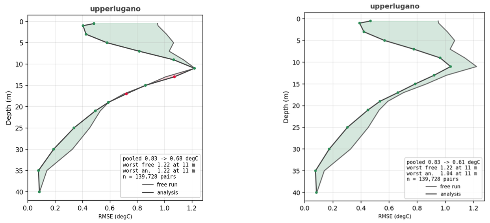{ width="800" .center }
/// figure-caption
Upper Lugano 2025: RMSE by depth with assimilation of unfiltered (left) and filtered (right) observations, scored against the same raw hourly observations.
///

**Result:** Without filtering (Figure 1, left) almost nothing is achieved at the thermocline, and the red fill around 13 and 17 m says it was made slightly worse: the filter is chasing a signal it cannot represent and fails to inject it into the simulation. With filtering (right) we get an improvement everywhere.

**Verdict:** The data becomes more meaningful, and more digestible, for the filter and we get the hoped-for improvement at intermediate depths. All other results use filtered observations.

**Reproduce:** `feat/da-combi`: `notebooks/calibrate_filter.py`, `notebooks/filter_observations.py`.

### Surface-only assimilation { #surface-only }

**Status:** ❌ Tested, not adopted · **Lakes:** Lower Lugano, Lower Zürich (plus Upper Lugano with surface data only)

**Question:** Several lakes have a surface station and nothing else. Is assimilating the surface enough?

**Setup:** Two lake sections where only surface data is available, with the same seasonal σ recipe applied to the single surface depth: Lower Lugano 0.41 °C mixed / 0.61 °C stratified, Lower Zürich 0.65 / 0.88 °C.

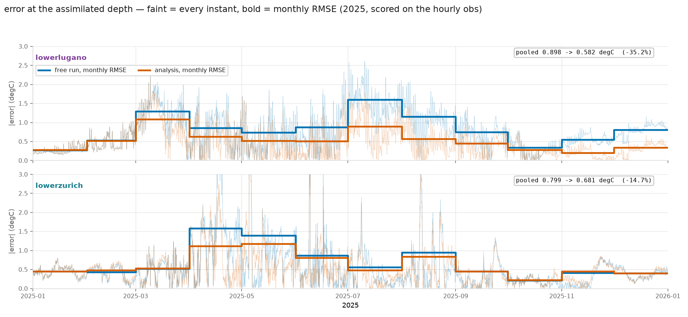{ width="800" .center }
/// figure-caption
Surface-only assimilation through 2025 at 1 m: Lower Zürich and Lower Lugano, free run vs assimilation.
///

**Result at the surface:** Both lakes improve at the assimilated depth of 1 m, but very unequally. **Lower Lugano 0.90 → 0.58 °C (−35 %); Lower Zürich 0.80 → 0.68 °C (−15 %).** The difference most likely comes from the error each free run makes, not from the filter. Each correction is the innovation (observation minus forecast) times a gain, and that gain stays small when the ensemble is narrow compared with σ. Our setup has a fairly narrow ensemble and a large σ, so a correction can only be large when the error is large. When the free-run error stays low, the corrections are small and hard to see. Zürich's error is low (around 0.4 °C) for most of the year, with only short large excursions, so the filter has less to correct over the year. In January–February, and also in November–December for Zürich, the assimilated and free-run curves in Figure 2 are indistinguishable. The difference appears in March for Lugano and April for Zürich and lasts through the stratified season.

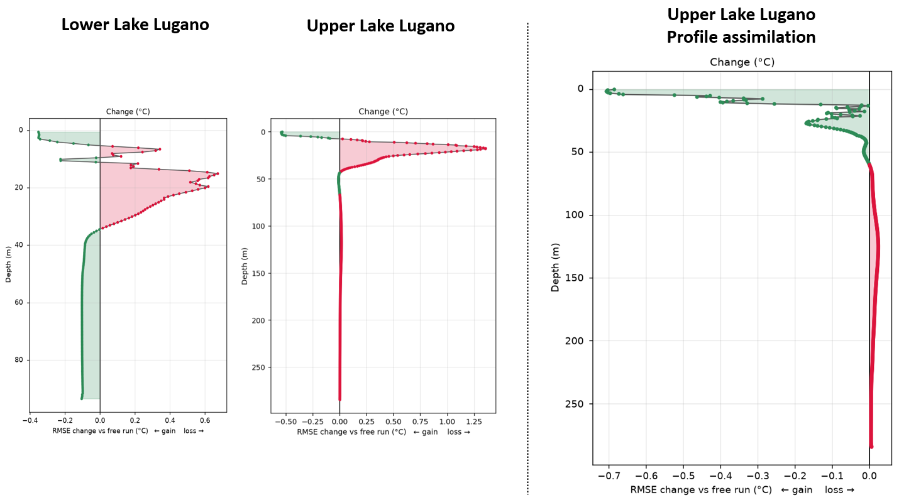{ width="800" .center }
/// figure-caption
RMSE against CTD casts: surface-only assimilation, Lower and Upper Lugano (left), and full-profile assimilation, Upper Lugano (right).
///

**Result in the column:** Figure 3, left: Lower and Upper Lugano with surface-only assimilation; right: Upper Lugano assimilating the full profile. Both scored against CTD casts, a sub-optimal reference: casts are instantaneous and very exposed to the variability problem described in [Method](method.md#observations), while our assimilation works on filtered daily values, and the two panels are different lake sections. Surface-only gains at the top and, weakly, in the deep in lower Lugano. Similar results are obtained when assimilating the upper Lake Lugano section with surface measurements only (note: deep results change). **Between them it loses badly: the RMSE degrades by up to 0.65 °C between roughly 10 and 35 m, more than the 0.4 °C it gains at the surface.**

**Profile assimilation gains almost everywhere** down to 60 m, up to 0.7 °C at the surface, and below that does essentially nothing, within 0.02 °C of the free run all the way to 280 m.

**Alternatives tried:** The model is 1D, so no matter how many stations report, the filter must be handed one value per depth. The freedom is in how that value and its uncertainty are constructed. We tried defining σ from **the observations alone** rather than from the model gap: when the spread *between stations* is large (from climatology), trust the value less; when a value is derived from *more* stations at run time, trust it more. We tried localizing the corrections ([Localization](#localization)), and arbitrarily prescribing a low σ of 0.3 °C. **The results change only at the surface and none of them improved the comparison against the CTD profiles at depth.**

**Verdict:** Profile assimilation shows clearly better gains against CTD, and it appears to do little harm where it has no information; **having profile information over the whole upper 30–40 m seems to be essential for correcting a 1D model.**

**Reproduce:** `feat/multi-station-obs`: Lower Lugano and Lower Zürich setups, `notebooks/sigma_rep_from_obs.py`.

---

## Observation σ { #sigma }

A single fixed σ by season ([Method](method.md#sigma)) is simple, well suited to operational use, and already gives significant improvement across the year and the water column. But the simple recipe has clear drawbacks, and each one suggests a fix:

- Seasonal aggregation assumes a clean mixed/stratified split, at the same calendar dates, across lakes and years. A finer temporal resolution (say monthly) would need more history than we have, and monthly conditions vary a lot from year to year.
- Thermocline layers in summer remain challenging to assimilate.
- Deep observations are trusted far too little, because their true representativeness error is much smaller than the depth-median σ.

In the tables below, "calibration" is the pooled NIS: 1 is perfectly consistent, below 1 over-cautious, above 1 over-confident.

### Depth-resolved σ { #sigma-depth }

**Status:** ❌ Tested, not adopted · **Lakes:** all seven

**Question:** Does σ resolved by depth, instead of collapsed to a median, do better?

**Setup:** Same fitting concept, resolved by depth.

| lake | gain, simple | gain, σ(z) | NIS simple (all / mixed / strat.) | NIS σ(z) (all / mixed / strat.) |
|---|---|---|---|---|
| upperlugano | −26.3 % | −25.5 % | 0.55 / 0.73 / 0.51 | 0.56 / 0.68 / 0.52 |
| maggiore | −28.5 % | −28.4 % | 0.87 / 0.38 / 1.04 | 0.91 / 0.38 / 1.13 |
| greifensee | −27.1 % | −28.5 % | 0.63 / 0.55 / 0.64 | 0.65 / 0.41 / 0.73 |
| geneva | −42.5 % | −41.8 % | 1.07 / 1.54 / 0.98 | 0.62 / 1.18 / 0.55 |
| aegeri | −35.2 % | −28.5 % | 0.94 / 0.66 / 1.14 | 0.75 / 0.63 / 0.79 |
| hallwil | −49.2 % | −50.6 % | 1.00 / 0.54 / 1.46 | 0.62 / 0.41 / 0.79 |
| murten | −34.2 % | −30.9 % | 0.60 / 0.96 / 0.50 | 0.62 / 0.66 / 0.59 |

**Result:** The structure of the budget looks visibly better: σ now follows the shape of the innovation profile instead of cutting across it. But the overall calibration stays about the same, because fixing the shape redistributes the misfit rather than removing it (the budget is more evenly distributed, not better in the pool). **And the RMSE gain barely moves**, while on Ägeri it gets notably worse (−35.2 → −28.5 %). The level stays too high for the same reason as in the seasonal σ of `simplified_final`: σ is still fitted on the free run's errors, and the purpose of assimilation is to make exactly those errors smaller, so the filter only ever sees smaller innovations than the ones σ was fitted on if assimilation works ([Rescaled σ](#sigma-scaled)).

**Verdict:** The depth fit changes the *shape* of the uncertainty profile but not its *level*, and it brings no gain over the seasonal σ: for the moment we see no reason to use it. Fixing the level is the next experiment.

**Reproduce:** `feat/da-combi`: `src/assimilator/sigma_rep.py`, `notebooks/fit_sigma_gap.py`.

### Rescaled σ { #sigma-scaled }

**Status:** ❌ Tested, not adopted · **Lakes:** all seven

**Question:** The depth fit had the right shape and the wrong amplitude. Does fixing the level help?

**Setup:** Since the free-run fit sets σ generally too high ([above](#sigma-depth)), we take a previous run's uncertainty profile and rescale it against **that run's own innovations**, with four numbers per lake to keep the risk of overfitting as low as possible: above and below 4 m (where the seiche filtering starts), for each of the two seasons.

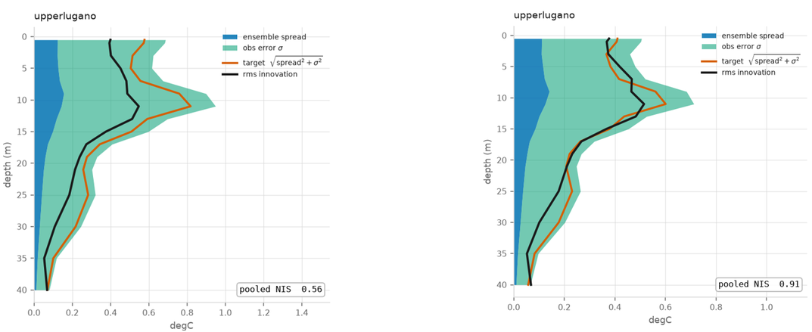{ width="800" .center }
/// figure-caption
Uncertainty budget with depth-resolved σ (left) and rescaled σ (right), Upper Lugano 2025.
///

| lake | gain, σ(z) | gain, scaled | NIS σ(z) (all / mixed / strat.) | NIS scaled (all / mixed / strat.) |
|---|---|---|---|---|
| upperlugano | −25.5 % | −26.9 % | 0.56 / 0.68 / 0.52 | 0.91 / 0.96 / 0.89 |
| maggiore | −28.4 % | −25.7 % | 0.91 / 0.38 / 1.13 | 1.13 / 0.87 / 1.16 |
| greifensee | −28.5 % | −30.5 % | 0.65 / 0.41 / 0.73 | 0.93 / 0.93 / 0.93 |
| geneva | −41.8 % | −41.9 % | 0.62 / 1.18 / 0.55 | 0.97 / 1.02 / 0.96 |
| aegeri | −28.5 % | −28.6 % | 0.75 / 0.63 / 0.79 | 1.00 / 0.94 / 1.01 |
| hallwil | −50.6 % | −49.9 % | 0.62 / 0.41 / 0.79 | 1.05 / 1.01 / 1.07 |
| murten | −30.9 % | −32.8 % | 0.62 / 0.66 / 0.59 | 0.94 / 0.99 / 0.91 |

**Result:** Figure 4 compares the two budgets on Upper Lugano. **As a calibration test this works very well**, as expected: every lake lands close to 1. Spring and winter remain hard in opposite directions, which is the price of the remaining two-season approximation. **The RMSE gains move only a little, some up, some down, and the simple setup still beats this calibrated version in several cases:** Some general tendencies are nonetheless visible. Calibration tends to score worse in spring, and that loss sits mainly at the surface. The depth-fitted experiments, on the other hand, tend to score better in deeper water and, for the scaled fit, in the winter months. At the thermocline we cannot generalise: of the two lakes with the largest losses there, Greifensee improves, closing part of its intermediate-depth degradation, while Ägeri gets worse.

**Verdict:** Filter self-consistency and filter accuracy are separate objectives: calibrating does not guarantee any improvement in performance. Calibration can offer a targeted repair at difficult depths and times, but not a reliable one. How well more complex or iterative fits would generalise to other years with the limited data at our disposal also remains questionable.

**Reproduce:** `feat/da-combi`: `src/assimilator/sigma_rep.py`, `notebooks/fit_scale_by_depth.py`.

### Fitting year { #fitting-year }

**Status:** ✅ Passes · **Lakes:** Ägeri, Hallwil, Greifensee

**Question:** The seasonal σ is independent of the filter, but not of the evaluation data: it was fitted on 2025, and every result here is scored on 2025. Does that matter? (2025 is the only year with profile observations on all seven lakes.)

**Setup:** Three lakes also have full records for 2023 and 2024 on an unchanged sensor chain. For those we refitted σ on 2023–24 and scored the result on 2025, changing nothing else.

| lake | σ fitted on 2025 | σ fitted on 2023–24 | RMSE gain, 2025 fit | RMSE gain, 2023–24 fit |
|---|---|---|---|---|
| aegeri | 0.24 | 0.27 | −35.2 % | −34.3 % |
| hallwil (mixed / strat.) | 0.41 / 0.39 | 0.33 / 0.53 | −49.2 % | −47.7 % |
| greifensee (mixed / strat.) | 0.52 / 0.94 | 0.52 / 0.91 | −27.1 % | −27.6 % |

**Result:** The fitted values do move between years, by up to a third (Hallwil's stratified season, odd case mentioned earlier). The result barely does. The gain changes by at most 1.5 points, and no depth differs by more than 0.03 °C. Hallwil's calibration even improves.

**Verdict:** Where it can be tested, **the choice of fitting year matters much less than one might think and the recipe itself**. Two caveats: the test covers three lakes and one scored year, and the forcing perturbation is still the one fitted on 2025, because the ICON reanalysis it needs does not reach back to 2024.

**Reproduce:** `master` at `20564a9`: `notebooks/generate_sigma.py`, fitted on 2023–24 (now `assimilate.py fit sigma`).

---

## Learning the errors online { #online-errors }

The σ fits above are made offline, on a reference year, and assume that year stands for the next ones. Here the errors are learned instead from the filter's own misses (innovations) as the run goes. It is one method with two switches (`R_rule` and `q` in `pn_online`), so three levels:

| | All to R | R split | R split + model error |
|---|---|---|---|
| Switches | `R_rule: consistency`, `q: false` | `R_rule: split`, `q: false` | `R_rule: split`, `q: true` |
| Observation error R | every excess miss: R² ← gap² − spread² | only the part of the miss that does not repeat from day to day | as R split |
| Model error | none | none | q, learned from the misses, added as daily noise on the profile |
| Ensemble spread | too small | too small | follows the error |
| Ägeri 2025: RMSE / NIS (free run 0.461, `simplified_final` 0.299 / 0.98) | 0.301 / 0.91 (first version: 0.398) | 0.290 / 1.76 | **0.275** / 0.67 |
| Upper Lugano 2025: RMSE (`simplified_final` 0.612) | first version: gain −27 % against −26 % | – | **0.584** |

RMSE against the raw hourly observations, NIS from the filter ([scoring](reference.md#run-config)).

The first version of "all to R" is the [adaptive σ](#adaptive-sigma) experiment (14-day window, uncentred forcing, no gross-error check). The [learned R and q](#uncertainty-band) introduces the split and q on Upper Lugano; the [Ägeri check](#online-aegeri) runs all three levels on the lake where the first version failed.

### Adaptive σ { #adaptive-sigma }

**Status:** ❌ Replaced by the [learned R and q](#uncertainty-band) · **Lakes:** all seven; CTD check on Upper Lugano

**Question:** Can σ follow the innovations as the run goes, with no free run, seasonal split or iterative fit?

**Setup:** At each depth, σ² is the mean squared innovation minus the mean ensemble spread² over the 14 days before each analysis, `σ(z,t)² = gap² − spread²`, with a 0.05 °C floor. The seasonal σ is used for the first 14 days, until the window fills.

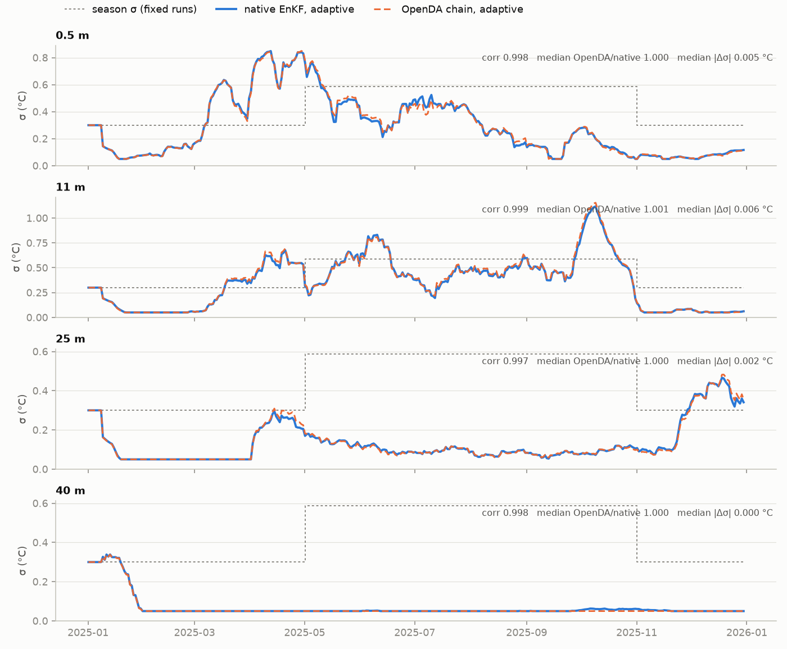{ width="800" .center }
/// figure-caption
Adaptive σ actually used, native EnKF vs OpenDA chain, against the seasonal σ, Upper Lugano 2025.
///

**Result:** On Upper Lugano σ climbs through the spring warming at the surface and peaks at the thermocline in October; below 25 m it falls well under the seasonal value (Figure 5). NIS is 1, as the estimator is built to produce, but the pooled RMSE barely moves (−26 → −27 %). The gain sits where the seasonal σ distrusted the observations (e.g. 30 m), and the 23 CTD casts, never assimilated, confirm it (better at 98 of 121 levels in the top 60 m). On the seven lakes NIS ends near 1 everywhere, but only Upper Lugano gets more accurate: the others lose a few points, and **Ägeri loses more than half its gain** (−35.2 → −13.6 %).

**Ägeri shows the failure mode:** from July to October the error grows between 10 and 20 m, at the thermocline ([Figure 10](#online-aegeri)). The estimator cannot tell whether a large miss comes from the measurement or from the model, so it always blames the observations. When the model starts misplacing the thermocline the misses grow, σ there climbs from 0.2 to 0.9 °C, the filter stops correcting that depth, and the error keeps growing.

**Verdict:** A self-tuning error model can look perfectly calibrated while degrading accuracy. It leaves two problems, which the [next experiment](#uncertainty-band) answers: σ takes every miss, also the persistent ones that come from the model, and the ensemble spread stays as small as before.

**Reproduce:** `adaptive_sigma`: the `adaptive_sigma` config block, native engine and OpenDA restart chain; `operational_openda-restart`: `src/assimilator/openda/restart.py`, the `openda_restart` config block.

### Learned R and q: an honest uncertainty band { #uncertainty-band }

**Status:** 🔬 Analysis done; 7-day reforecasts are the next step · **Lakes:** Upper Lugano, 2025

!!! abstract "In short"
    - **The operational setup is too confident.** In `simplified_final` the ensemble spread is a quarter of the error (spread/RMSE 0.26). Its band only looks right because of one large, fixed observation error (0.30 °C in winter, 0.59 °C in summer, at every depth).
    - **R and the model error q can be learned online** from the filter's own misses, with one parameter (a ~20-day memory) and no tables to fit per lake.
    - **Slightly more accurate, and honest:** RMSE 0.612 → 0.584 °C, CRPS 0.313 → 0.246 °C, and the spread follows the error every month (spread/RMSE 0.98 against the filtered observations).
    - **What it learns is physical:** R peaks at 0.4 °C at 9 m in summer (internal waves) and stays at the sensor error in winter and at depth; q is largest near the surface in summer.

**Question:** [Adaptive σ](#adaptive-sigma) left two problems: it blames every miss on the observations, so a drifting model is answered by trusting the data less (the Ägeri runaway), and the ensemble spread stays far smaller than the error ([Open problems](open-problems.md)). Can R be learned so that it takes only what really is observation error, and the rest be carried by the ensemble as a model error q?

**Idea:** three sources, kept apart. **R** is what a 1D lake-mean model cannot represent (sensor noise, internal waves). **q** is what it represents but gets wrong, added as a daily noise on the temperature profile, as in FLARE ([Thomas et al., 2020](../literature-review.md#thomas-2020)). **Bias** is neither, and is not put into either. R and q are learned from the misses d = observation − forecast, with two standard rules.

| | Rule | Why it works | Reference |
|---|---|---|---|
| **q** (daily model error) | Each day q² moves by 5 % of (d² − spread² − R²) | On average the miss must be as large as predicted, d² = spread² + R². Misses too large → q up, too small → q down | Innovation consistency (Mehra 1970; Li et al. 2009) |
| **R** (observation error) | Each day R² moves by 5 % of (d_a·d − d·d_next), using yesterday's miss d, its post-analysis miss d_a and today's miss d_next, at the same depth | Observation noise is new every day, model error persists: if misses repeat from day to day, the filter trusts the observations too little. R is right when they stop repeating | Kailath 1968; Mehra 1970; Desroziers et al. 2005 |
| **Memory** λ = 0.95 | Each day counts 5 %, about the last 20 days dominate | Longer than single events, shorter than the seasons. λ = 0.98 (~50 days) gives the same skill (RMSE 0.585, coverage 0.93) | – |

The rest of the setup, and how each part is done:

- **Shape of the noise in depth (fixed).** Only the size q is learned per depth; how errors at different depths move together is a fixed correlation, one for the mixed and one for the stratified season, measured from the free run's day-to-day error. It matches the correlation of the run's own misses (e.g. 1–3 m 0.70 vs 0.76; 9–13 m in summer −0.29 vs −0.26, the thermocline moving up or down), so it is representative for this lake (and year for now).
- **Gross errors.** An observation whose miss is more than 5 standard deviations (NIS > 25) is not assimilated, but still counts when q is learned, so a q that is too small cannot reject the very misses that should raise it.
- **No shift of the mean.** Each day's noise is centred across members, so it adds spread without moving the ensemble mean.
- **Stable profiles.** After the noise, any density inversion in a member is merged into its volume-weighted mean, so the heat content is unchanged. Only what the noise can cause is touched: 0–50 m (the noise reaches the deepest observation at 40 m and fades to zero over the next 10 m) and inversions larger than 0.001 kg/m³ (about 0.01 °C; the model's own are smaller).
- **Start.** R starts at the sensor error (0.05 °C, also its lower limit) and learns only after 15 days, while the ensemble builds its spread; q starts at 0.

**Result (daily DA, 2025):**

| Run | RMSE (°C) | CRPS (°C) | spread / RMSE | 90 % band incl. R | spread only |
|---|---|---|---|---|---|
| Free run | 0.831 | – | – | – | – |
| `simplified_final` (fixed σ, no noise) | 0.612 | 0.313 | 0.26 (0.15) | 0.95 (0.88) | 10–40 % (10–40 %) |
| **Learned R and q (`pn_online`)** | **0.584** | **0.246** | **0.98** (0.43) | 0.94 (0.79) | **80–90 %** (55–85 %) to 25 m |

*Upper Lugano 2025. RMSE and CRPS against the raw hourly buoy observations; spread/RMSE and the bands against the filtered observations at the 16 assimilated depths, raw in brackets ([scoring](reference.md#run-config)). "Spread only": share of observations inside mean ± 1.645 × spread, the part of the band a forecast carries.*

Both bands contain about 90 % of the observations, but for different reasons. Against the raw readings the learned band covers less (79 % against 88 %): its R describes the filtered reading, and the internal-wave signal the filtering removes is in neither the spread nor R. The `simplified_final` band is almost all fixed observation error: ±1 °C at 25–40 m, where the lake changes by hundredths, and so large that the deep water is barely corrected (25 m stays ~0.3 °C too warm, close to the free run). The learned band is tight where the lake is calm and wide where it is not (Figure 6), and its spread matches the error month by month (Figure 7). The learned R has a clear depth structure, unlike the single fixed value (Figure 8), and both R and q follow the seasons (Figure 9): R stays at the sensor error in winter and at 40 m and rises to about 0.5 °C at 9 m in summer, where internal waves move the thermocline; q is largest at 1 and 9 m from spring to September and drops to about 0 at 40 m after May. Inversions stay within what the free run produces itself (below 3 m, at most 1.9 % of hours in July, against 5.5 % in the free run).

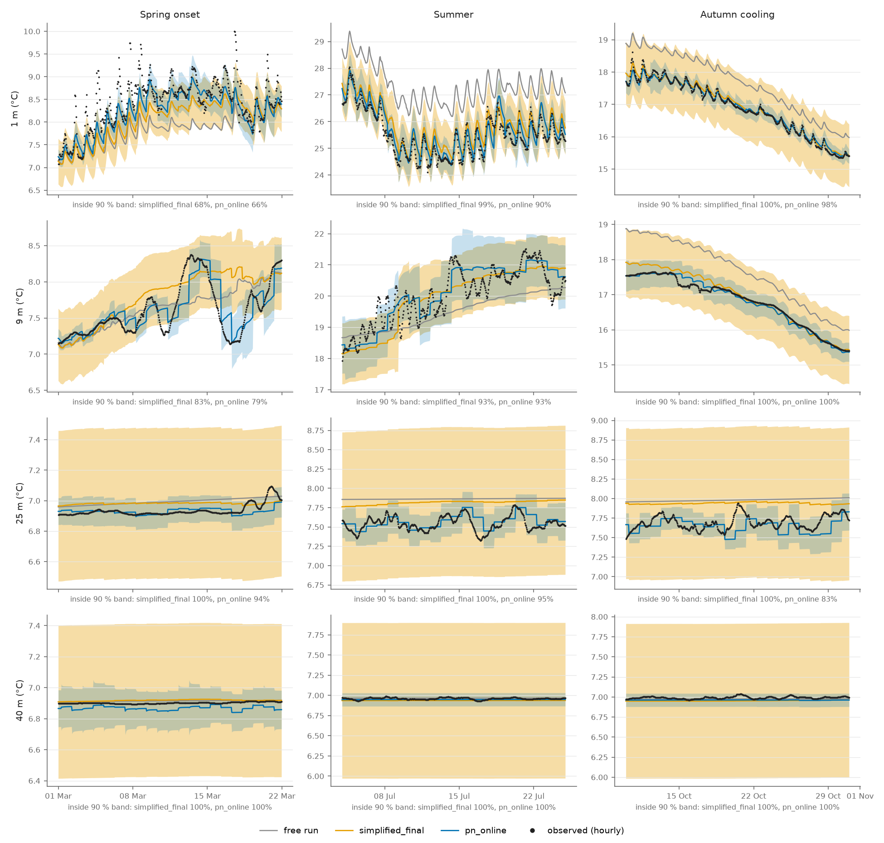{ width="880" .center }
/// figure-caption
Upper Lugano 2025: hourly filtered observations, free run, and the ensemble mean with its 90 % band for the buoy reading, mean ± 1.645 √(spread² + R²), for `simplified_final` and the learned R and q, at 1, 9, 25 and 40 m in spring onset, summer and autumn cooling. Under each panel, the share of observations inside each band.
///

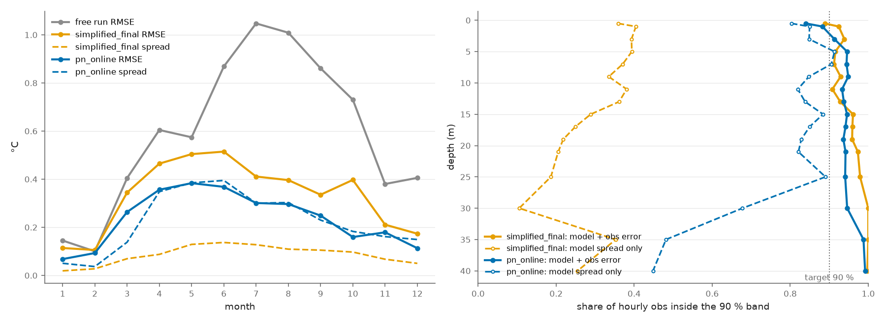{ width="880" .center }
/// figure-caption
Upper Lugano 2025, **against the filtered observations** at the 16 assimilated depths: (left) monthly RMSE of the ensemble mean (solid) against the ensemble spread (dashed): spread ≈ RMSE means an honest band; (right) coverage of the 90 % band by depth, with R (solid) and spread only (dashed).
///

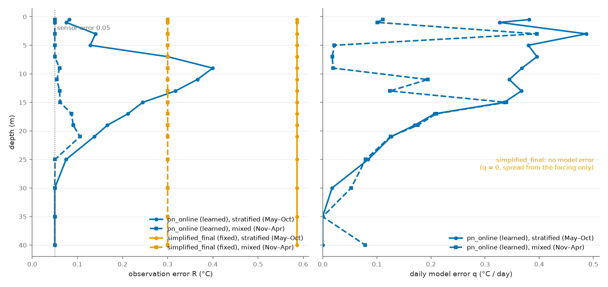{ width="880" .center }
/// figure-caption
Upper Lugano 2025, median over each season: (left) observation error R, learned (blue) against the fixed σ of `simplified_final` (orange); (right) the learned daily model error q. `simplified_final` has no model error.
///

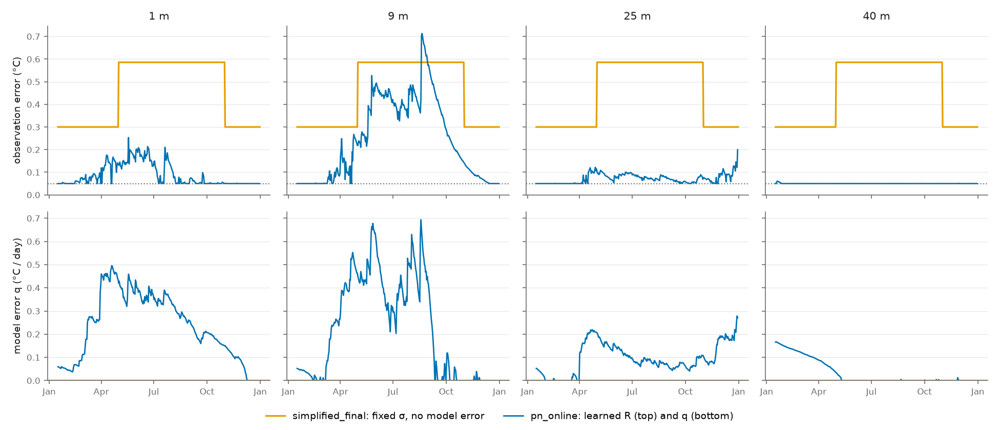{ width="880" .center }
/// figure-caption
Upper Lugano 2025, at 1, 9, 25 and 40 m: (top) observation error R, learned (blue) against the fixed σ of `simplified_final` (orange), dotted line the 0.05 °C sensor error; (bottom) the learned daily model error q. The first 15 days (warm-up) are not shown.
///

**Limits:**

- **The R/q split is defined by persistence.** Internal waves lasting several days count as model error, so at 5 m R is smaller than an observation-based estimate.
- **q falls slowly after active periods.** It rises within 2–3 weeks but takes 6–7 weeks to come down, because a calm day can lower it only a little and the ensemble keeps its spread. The band is wider than needed in autumn (98–100 % of observations inside).
- **Large corrections at the thermocline:** without a step cap, 18 analyses move the water below 4 m by more than 1 °C (largest 2.0 °C). On [Ägeri](#online-aegeri) the same happens, less often: 3 analyses above 1 °C (largest 1.4 °C at 4 m in April), and the run is still the most accurate at those depths. The extra spread from q makes the filter trust the observations more, so it corrects in bigger steps. If the aim is to keep jumps and shocks to the model small, the R-only versions are decisively better: on Ägeri no correction exceeds 0.8 °C with the R split, or 0.43 °C with all to R. 
- **Deep water in summer:** q drops to 0 at 30–40 m, so the spread-only band covers 45–70 % there (errors of a few hundredths of a degree).
- **One year, in sample:** Each depth learns q on its own, so the winter profile of q is noisy. A second lake is checked [below](#online-aegeri).
- **The depth correlation is measured on 2025 only:** Pooling more years as the record grows (2024–2026 now available) will make it a lake property rather than a property of one year.

**Verdict:** Learned R and q could be an automatic method to run the analysis: as accurate or slightly better than the operational setup (−5 % RMSE, −21 % CRPS against the raw observations), honest about its uncertainty, physically interpretable, one parameter, and standard references for each step.

**Still to do:** score it against the 23 Upper Lugano CTD casts, as adaptive σ. The run on Ägeri is the [next section](#online-aegeri).

**Next step: 7-day reforecasts.** The band has only been tested in the daily cycle (0–24 h).

1. Rerun the learned R and q with the analysis states saved every 7 days, then run weekly 7-day reforecasts from them with the observed weather, and score them by lead time against persistence and the free run (CRPS, RMSE, coverage).

2. **What to look for:**
    - coverage stays near 90 % from day 1 to day 7 (below: q too small in forecasts; above: too large, e.g. in autumn);
    - whether the seasonal surface bias (summer too warm, spring too cold) still dominates the day-7 error;
    - whether the forecast ideas below improve the surface at longer leads.

3. **Real weather:** archive the ICON ensemble forecasts (lake mean, per member and lead) and repeat with them as forcing, each DA member paired with one weather member. With the observed weather the band is a lower bound; this step makes it a forecast band. Check that the band is not too wide at long leads (q partly absorbs forcing error that the weather ensemble then also carries).

**Ideas to improve the forecasts (to test with the reforecasts).** Exploratory reforecasts from an earlier, hand-tuned version point to two ideas. Treat them as hypotheses to confirm, not results:

- **Lake wind.** From June to October the station wind used as forcing is 12–25 % weaker than the wind measured on the lake (Castagnola buoy). Idea: scale the forecast wind by the buoy/model ratio of the previous weeks. Look for: a lower surface error at days 3–7 in summer, where the seasonal bias dominates.
- **Wind spread.** The members' wind is too alike: the real wind fell inside the members on only about half of the days. Idea: give each member a fixed wind factor between ×0.7 and ×1.4 (spread evenly across members, mean ×1), the typical day-to-day mismatch between lake and station wind. Look for: surface coverage at longer leads, and that the band does not grow too wide (a member stays windier for the whole forecast, while the real mismatch changes within about a day). It should add to q, not replace it (earlier the wind spread explained only about 10 % of the forecast error variance).

**Reproduce:** Branch `feat/online_error`, config block `online_errors`.

### Ägeri check: one method, three levels { #online-aegeri }

**Status:** ✅ Done · **Lakes:** Ägeri, 2025

**Question:** Ägeri is where adaptive σ ran away. Does the new method avoid it, and what do the R split and q each add?

**Setup:** Three runs of `pn_online` that differ only in the two switches (table [above](#online-errors)). Everything else as the learned R and q on Upper Lugano: memory λ = 0.95, centred forcing, gross-error check (NIS > 25), R starting at the sensor error 0.05 °C. The depth correlation of q comes from the Ägeri free run. Compared with `simplified_final` and the first adaptive σ run.

| Run | RMSE (°C) | CRPS (°C) | spread / RMSE | 90 % band incl. R | NIS |
|---|---|---|---|---|---|
| Free run | 0.461 | – | – | – | – |
| `simplified_final` (fixed σ 0.237) | 0.299 | 0.140 | 0.22 (0.16) | 0.93 (0.89) | 0.98 |
| Adaptive σ, first version | 0.398 | 0.170 | 0.15 (0.12) | 0.93 (0.88) | 0.90 |
| All to R | 0.301 | 0.131 | 0.21 (0.16) | 0.93 (0.87) | 0.91 |
| R split | 0.290 | 0.128 | 0.17 (0.12) | 0.82 (0.76) | 1.76 |
| **R split + model error** | **0.275** | **0.100** | **0.76** (0.49) | 0.94 (0.88) | 0.67 |

*Ägeri 2025, 2,503 profile times. RMSE and CRPS against the raw hourly profiler at all 239 depths; spread/RMSE and the band against the filtered profiler at the 22 assimilated depths, raw in brackets; NIS from the filter ([scoring](reference.md#run-config)). The ported code (`online_errors`) reproduces both levels it was run on: R split + q 0.276 °C, R split identical up to 10 May.*

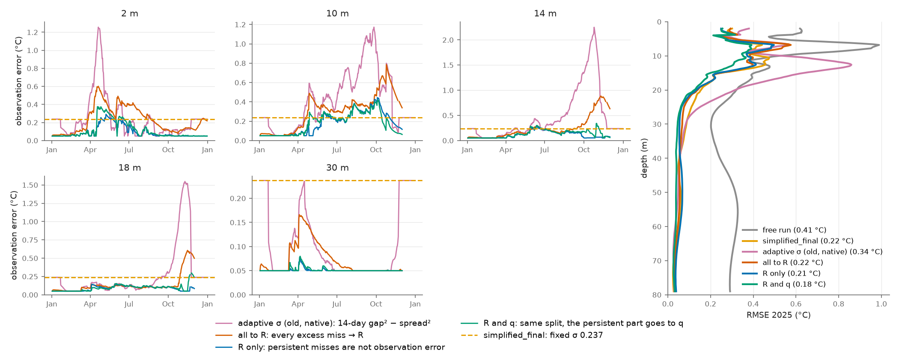{ width="880" .center }
/// figure-caption
Ägeri 2025: (left) observation error at 2, 10, 14, 18 and 30 m: the first adaptive σ (rebuilt from its saved misses), all to R, R split without and with q, and the fixed σ of `simplified_final`; (right) RMSE by depth **against the filtered profiler**, over all 2025 profile times and all profiler depths, with each run's RMSE over the whole profile (raw values in the table above).
///

**Result:** Figure 10 shows three steps.

- **All to R no longer runs away.** With the new settings it is as accurate as `simplified_final` (0.301 against 0.299 °C), against 0.398 for the first version. Which setting stopped it (centred forcing, the gross-error check, the memory, or the start at 0.05 °C) is not separated. The mechanism is still visible, only weaker and later: at 14 m R climbs to 0.9 °C in November, against 0.24 °C for the fixed σ (the first version climbed earlier and higher).
- **The split keeps R physical.** R stays at or below about 0.45 °C at every depth and the thermocline bulge disappears (RMSE 0.290). But without q nothing carries the misses it takes out of R: the filter is over-confident (NIS 1.76, the band holds 82 %).
- **q gives the main gain.** RMSE 0.301 → 0.275 °C and CRPS 0.131 → 0.100, lowest at 165 of the 239 depths and within 0.01 °C of the best at 228 (12–14 m: 0.43–0.54 → 0.38–0.51 °C), and the spread rises from a fifth to three quarters of the error. With NIS 0.67 it is now somewhat cautious.

**Verdict:** The same story as on Upper Lugano. Use the split: R then stays physical whatever the model does. Add q whenever the spread matters, which is always for a forecast band; without it the filter is over-confident. The old failure is the reason for the split, but on Ägeri the new settings had already removed most of it.

**Reproduce:** Branch `feat/online_error`, config block `online_errors`.

---

## Model spread and structure { #model-spread }

The problems above all point to an under-dispersed ensemble ([Open problems](open-problems.md)). These experiments look at the model side.

### Vertical localization { #localization }

**Status:** (✅) Positive, potentially to be adopted · **Lakes:** all seven (radii); example Greifensee

**Question:** Do the failures in the deeper layers come from spurious correlations? With 20 members, a small correlation is potentially indistinguishable from sampling noise, and without a limiting mechanism the filter acts on it anyway. Besides, observations often stop well before the lake floor, and stratification complicates the profiles. Localization forces small correlations to zero instead of trusting them.

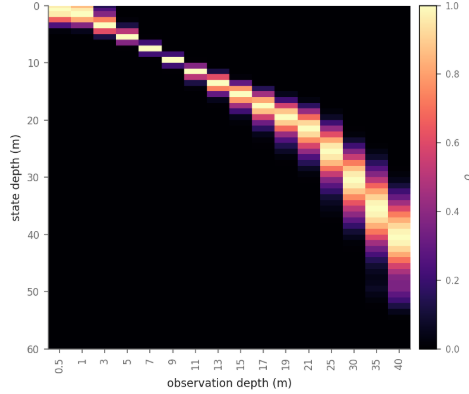{ width="380" .center }
/// figure-caption
Localization taper: correlation weight by state depth and observation depth.
///

**Setup:** Radii are derived offline, per lake, from a free ensemble (perturbed forcing, no analysis) in the stratified season: the ensemble anomalies (each member minus the ensemble mean) are correlated between depths, pooled over all members and times, and the radius at a given depth is the smallest separation at which that correlation first drops below a threshold of 0.45. That is 2/√20, the level below which a correlation estimated from 20 members cannot be told apart from sampling noise (two-sided 5 %): links weaker than this are ones our 20-member filter would mostly act on by chance. The radius is then used as the support of a smooth taper (Figure 11) (weight 1 at zero separation, falling to 0 at the radius). Two matrices built from the taper modify the Kalman gain. The radii come out narrow near the surface, where the gradient is sharp, and wider with depth, where the column is more coherent. Conceptually, corrections from far-away cells shrink, less spread is removed in general, and the extra spread gives a larger gain on the links that remain. Implementation details are in [Localization implementation](#localization-implementation).

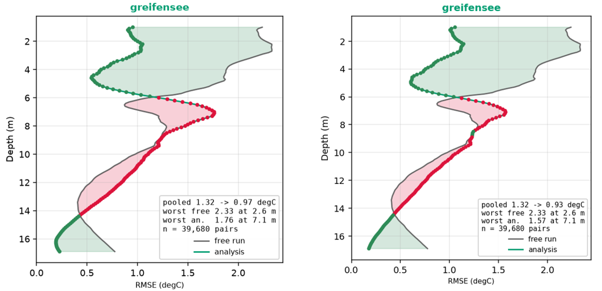{ width="800" .center }
/// figure-caption
Greifensee, August 2025: error profile without localization (left) and with it (right).
///

**Result:** On Greifensee in August for example, localization brings the pooled error from 1.32 to 0.93 °C (Figure 12, left) instead of 0.97 °C (right), and trims the worst analysis error at 7.1 m from 1.76 to 1.57 °C. But the band between about 6 and 14 m is still worse than the free run in both cases. **The improvements, when present, remain small.**

**Verdict:** **Long-range spurious correlations don't seem to be a central problem in our lakes in the current set up.** We provide localization as an optional element rather than part of the operational configuration.

**Next step:** The scheme is measured per lake and ready to be tested and integrated where that stops being true: with more spread at depth, or in 3D, where spurious horizontal correlations are a bigger concern ([3D](#3d)).

**Reproduce:** `feat/da-combi`: `src/assimilator/localization.py`, `notebooks/localization.py`.

#### Localization implementation { #localization-implementation }

Radii are derived offline per lake from a free ensemble run in the stratified season (`notebooks/localization.py`): member anomalies are correlated between model depths, pooled over (member, time), and the radius at a depth is the smallest separation at which that correlation first drops below the threshold (0.45 = 2/√20, the sampling floor of a 20-member ensemble). The stratified radius is used all year: in a mixed column it localizes harder than needed, which discards some real information but never lets a spurious correlation through. That radius is the **support** of a Gaspari–Cohn taper: weight 1 at zero separation, falling smoothly to exactly 0 at the radius. Two matrices are built from it: a *(state, obs)* taper for `PHᵀ` and an *(obs, obs)* taper for `HPHᵀ`.

**Both sides must be tapered, not just `PHᵀ`:** The tempting shortcut is to taper only the cross-covariance, since that is the term that spreads the correction. But the gain also contains `(HPHᵀ + R)⁻¹`, and if that inverse is still built for the *full* observation set, the two halves of the gain disagree about which observations exist.

**The taper must not be a boxcar:** A binary on/off mask can produce a correlation structure that is no longer positive semi-definite: negative eigenvalues, and a covariance matrix that is mathematically invalid.

The taper accepts two arbitrary depth axes; per-depth radii are interpolated from the table and held **flat past the table's ends** rather than extrapolated; and the support of a pair is the **mean** of the two radii, which is what keeps ρ symmetric. Deleting `localization/<lake>.json` is the kill switch; the scheme falls back to a flat 5 m radius.

The intended consequence is that nothing far below the deepest observation gets updated. The deep water free-runs, and that is correct behaviour rather than a limitation: there is no information down there, so the model should be trusted rather than nudged by noise.

### Parameter sensitivity { #param-sensitivity }

**Status:** 🔬 Open · **Lakes:** Upper Lugano

**Question:** An obvious source of additional spread is the model itself. Three clear candidates, all already used in Simstrat's own calibration: `f_wind` (wind factor: wind speed is multiplied by it), `p_lw` (longwave radiation factor: longwave irradiance is multiplied by it) and `a_seiche` (seiche factor: how much wind energy is absorbed by internal waves). How much spread could they give, and where?

**Setup:** Seven continuous free runs over 2025, identical unperturbed forcing and identical warm start: control plus a low/high pair per parameter (`f_wind` ±10 %, `p_lw` ±3 %, `a_seiche` ×3 / ÷3, all inside the lake-calibrator bounds). Shown with the control subtracted, at 1, 11 and 30 m, against raw hourly observations. Light grey is the free ensemble from forcing perturbation; darker grey the assimilated one.

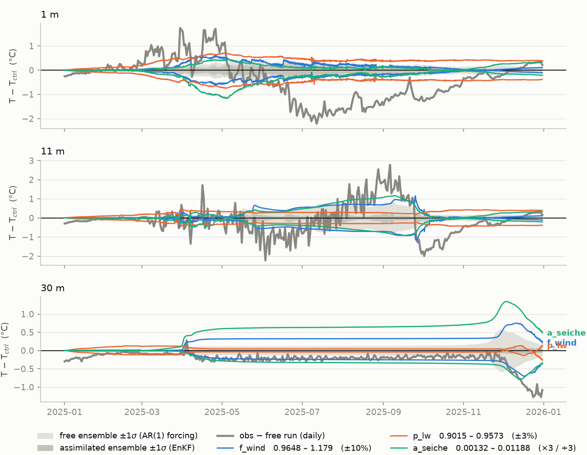{ width="800" .center }
/// figure-caption
Parameter sensitivity envelopes at 1, 11 and 30 m, Upper Lugano 2025, control subtracted, against raw hourly observations; light grey: free forcing ensemble, darker grey: assimilated ensemble.
///

**Result:** In Figure 13, at **1 m**, the error to explain reaches −2 °C in midsummer. The AR(1) forcing ensemble is about ±0.3 °C. The parameter envelopes reach 0.5–1.2 °C. At **11 m**, observations minus free run peaks near +3 °C in September. The forcing spread is still around ±0.3 °C, but `a_seiche` and `f_wind` open to about ±1 °C, and they open *in the stratified season*, which is exactly where more spread would be particularly helpful. At **30 m** the error is smaller, but more spread would still help.

**Verdict:** Parameter variability could be a viable way to insert uncertainty into the deep column. Two ways to use it follow: perturbing the parameters, or estimating them.

**Reproduce:** Not in the repository; easily reproducible, scripts available from the author on request.

### Parameter perturbation { #param-perturbation }

**Status:** (✅) Positive, potentially to be adopted · **Lakes:** Upper Lugano

**Question:** Parameter differences are structural, so the analysis should have a harder time collapsing them, and it moves uncertainty away from the observation error and toward the model, where it partly belongs: more model spread means the observations are trusted more. Does it help the filter?

**Setup:** Seven assimilation experiments, native EnKF (seasonal σ). The only thing that changes is which model parameter is spread across the members, and by how much. Members are spread deterministically around the calibrated value, and the control member keeps it.

| perturbation | mean spread (°C) | spread below 19 m | pooled NIS | RMSE, hourly |
|---|---|---|---|---|
| none (operational) | 0.072 | 0.033 | 0.55 | −26.3 % |
| `a_seiche_w` ×/÷ 5 | 0.072 | 0.033 | 0.55 | −26.3 % |
| `f_wind` ±10 % | 0.074 | 0.034 | 0.54 | −26.5 % |
| `a_seiche` ×/÷ 5 | 0.082 | 0.039 | 0.55 | −26.1 % |
| `p_lw` ±5 % + `a_seiche` ±80 % | 0.084 | 0.036 | 0.50 | −27.3 % |
| `p_lw` ±10 % | 0.090 | 0.035 | 0.49 | −27.4 % |
| `f_wind` ±50 % | 0.108 | 0.052 | 0.48 | −27.3 % |
| `p_lw` ±25 % | 0.116 | 0.037 | 0.44 | −28.3 % |

**Result:** **It works in the direction predicted, but it is small.** More parameter spread gives a slightly better analysis. The best case, `p_lw` ±25 %, moves RMSE from −26.3 % to −28.3 %, and it cuts the total depth-months made worse by assimilation from 41 to 25 out of 192. The corrections become bigger (median 0.013 → 0.017 °C at the surface), which is what a filter with a wider ensemble is supposed to do.

**The amplitudes in parameter perturbations that achieve this are not defensible.** `p_lw` ±25 % is an eightfold exaggeration of the ±3 % used in the sensitivity test, and the calibrated values across our seven lakes span less. The perturbations we *can* eventually justify (`f_wind` ±10 %, `a_seiche` ×/÷ 5) change essentially nothing: 0.072 → 0.074 and 0.082 °C of spread. **σ still dominates** and the imbalance grows with depth.

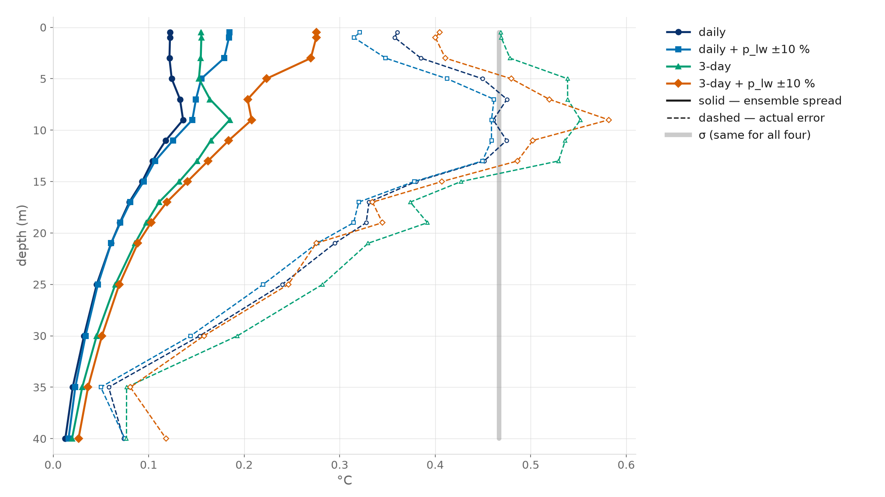{ width="800" .center }
/// figure-caption
Upper Lugano 2025: ensemble spread (solid) vs actual error (dashed) and σ (grey), daily and 3-day assimilation, with and without p_lw ±10 %.
///

**Where it becomes interesting is at lower frequency:** In Figure 14, solid lines are ensemble spread, dashed the actual error it should cover, grey σ. With `p_lw` ±10 %, the spread grows by about a quarter at daily frequency, and by more than a third when assimilating every 3 days, because the parameter differences have longer to act between analyses. At 3 days this is enough to bring the accuracy back to almost exactly the daily result, while assimilating a third of the profiles.

**Verdict:** Not adopted at defensible amplitudes; only worth it at lower assimilation frequencies.

**Next step:** The 3-day result is a quick test only: the deepest measurement actually got worse, so the way the additional spread is generated needs more care, but it is a promising direction.

**Reproduce:** Not in the repository; scripts available from the author on request.

### Joint state–parameter estimation { #joint }

**Status:** 🔬 Open · **Lakes:** Upper Lugano

**Question:** Instead of fixing the parameter spread, can the filter estimate the parameters together with the temperature? There is precedent in the literature (e.g. the FLARE framework of [Thomas et al. (2020)](../literature-review.md#thomas-2020)).

**Setup:** The filter updates `f_wind`, `p_lw` and `a_seiche` at every analysis. At the start each of the 20 members draws its own set of values around the calibrated ones: `p_lw` with a 5 % spread in logit space, bounded to 0.8–1.2; `a_seiche` and `f_wind` in log space, with a spread of ×1.65 and about 10 %. The transforms keep the parameters positive and within bounds, and the draws are stratified and shuffled so the three parameters start uncorrelated. The transformed parameters are appended to each member's temperature profile as an extended state. Since they are not observed, they change only through their ensemble covariance with the observed temperatures, and the temperature update itself is unchanged. Between analyses they stay fixed. Each update narrows their spread; a floor holds the spread from collapsing.

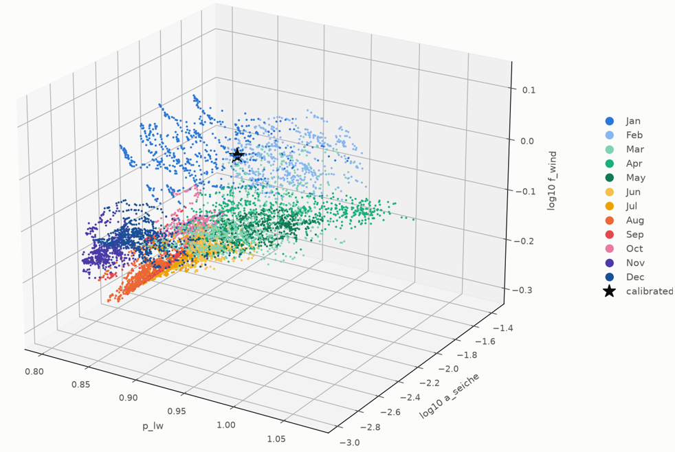{ width="800" .center }
/// figure-caption
Joint state–parameter estimation, Upper Lugano 2025: the members' values of the three parameters, coloured by month; the star marks the calibrated values.
///

**Result:** The cloud in Figure 15 shows the members' values through 2025, coloured by month; the star marks the calibrated values. **They do not converge.** They keep moving with the seasons, with much less wind and much more seiche mixing in summer, and the longwave factor pinned to its lower bound. The filter is using the parameters to absorb the seasonal bias. The accuracy ends up the same as without updating them, but reached in a different way.

**Verdict:** That opens real questions. Can a parameter be updated daily? Is 20 members enough for a joint state? Do the parameters stay physically defensible (broad bounds help, but probably something tighter is needed)? And there is an underlying attribution problem: we change the model's physics and its state at the same time on limited evidence, so the parameters can absorb errors that aren't theirs, and they trade off against each other.

**Next step:** A single run both corrects the temperatures and yields a distribution of the parameters, which could be a cheap first estimate to compare against a traditional calibration or to analyse potential systematic model failures. Coming back to the spread question, the next step would be adding justified random variability to the model state itself: structural uncertainty through state perturbation (see [Uncertainty band](#uncertainty-band)).

**Reproduce:** Not in the repository; scripts available from the author on request.

### Deep mixing { #deep-mixing }

**Status:** 🔬 Open · **Lakes:** Lake Lugano, 1987–2025

**Question:** Can assimilation improve the representation of deep mixing in Simstrat?

**Setup:** The buoy stops at 40 m, but for Lake Lugano there are almost 40 years of CTD casts, one every two weeks, down to 280 m, and we started by assimilating those. The profiles were thinned to a coarser grid as described in [Method](method.md#observations); the seiche filtering is not possible on fortnightly casts.

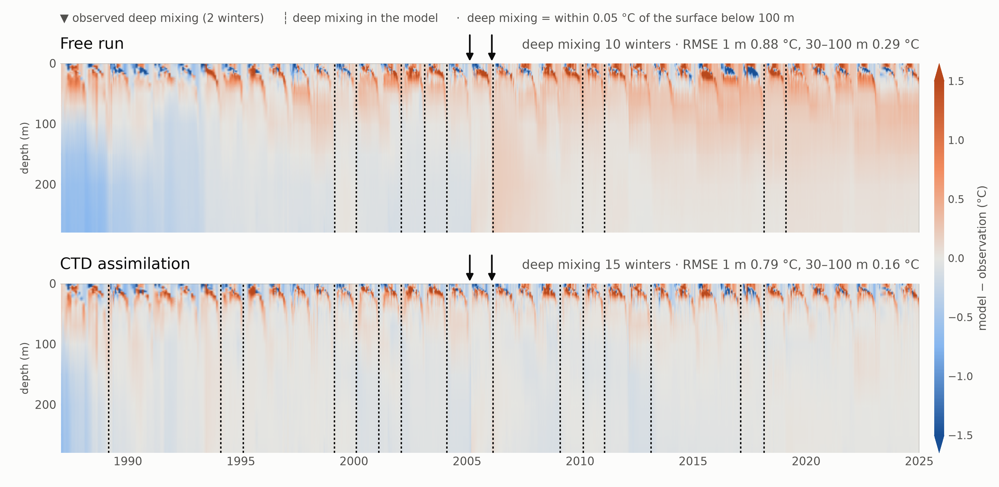{ width="880" .center }
/// figure-caption
Lake Lugano, 1987–2025: model − observation, free run vs CTD assimilation; arrows mark the winters the lake mixed below 100 m.
///

**Result:** The free run starts too cold in the deep water and slowly builds up a warm bias. It mixes all the way below 100 m in 10 winters, while the lake did so in only two (the arrows in Figure 16). With assimilation the deep temperatures are corrected: **RMSE between 30 and 100 m almost halves, 0.29 → 0.16 °C**, and at 1 m it drops from 0.88 to 0.79 °C.

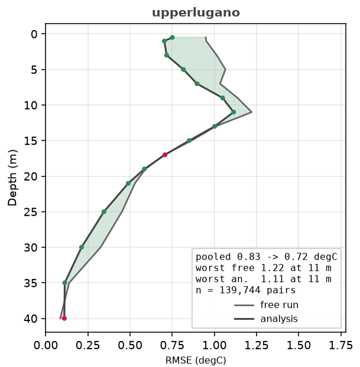{ width="380" .center }
/// figure-caption
Independent check of the CTD-assimilated run against the 2025 Upper Lugano buoy.
///

Against the 2025 buoy, which this run never saw, the error still drops from 0.83 to 0.72 °C. **But look at the dotted lines in Figure 17: deep mixing becomes more frequent, 15 winters instead of 10.**

**Verdict:** For now, assimilating temperature fixes the temperature but tends to make the mixing worse. Correcting the state may change when and how deep the model overturns.

**A later finding may explain part of this:** the forcing perturbation makes every member windier than the control ([Centred forcing perturbations](#centred-forcing)), and more wind brings more mixing. The Lugano run above was made before this was found, with uncentred forcing. On Geneva, with centred forcing, the free run and the assimilated run mix to the bottom in the same winters (both still too often), but Geneva has not been run without centring, so the comparison is indirect. The Lugano run has not yet been repeated with centred forcing.

**Reproduce:** Not in the repository; scripts available from the author on request.

### The same layout in 3D { #3d }

**Status:** (✅) Positive, potentially to be adopted · **Lakes:** Lake Lugano (Delft3D-FLOW), one-month test window

**Question:** Does the ensemble DA layout transfer to a 3D model, so that it can sit beside Simstrat in the module as an optional engine?

**Setup:** Delft3D-FLOW on Lake Lugano, driven the same way: OpenDA treats the model as a black box, writes a restart file, launches the model in a container, reads the output, adjusts the restart, and repeats, so the simulation advances window by window. The model is expensive, so these experiments use 7 members instead of 20. A big new thing in 3D is that the covariance also spreads a single station's correction *horizontally* to nearby cells, so one buoy can inform a whole region. That is attractive, because we have few stations, and risky at the same time: with seven members, spurious horizontal correlations become a real concern, more so than in 1D.

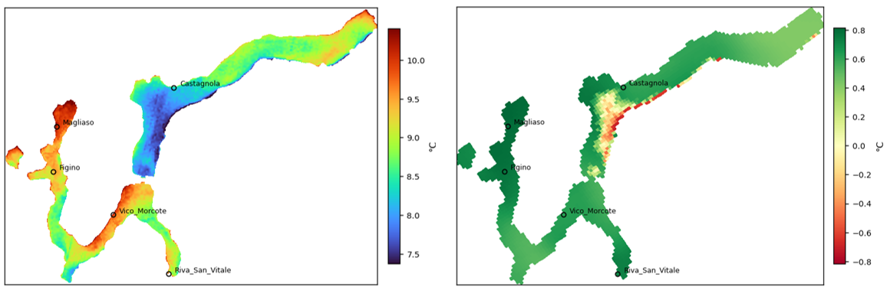{ width="800" .center }
/// figure-caption
Delft3D-FLOW, Lake Lugano: satellite surface temperature (left) and cells where the assimilated run is closer to it than the operational run (right, green).
///

**Result:** Surface-only assimilation of the five stations around Lake Lugano gives promising first results: against a satellite surface-temperature snapshot (Figure 18, left), the assimilated run is closer than the operational Alplakes run in 94 % of the cells (right, green).

**Next step:** The first results point clearly at the need for a vertical localization mechanism, or for deep measurements where they exist. Beyond that, it opens up possibilities to explore also assimilating the satellite surface temperature itself, providing the whole lake surface, but at lower resolution.

**Reproduce:** Not in the repository; scripts available from the author on request.

---

## Recent work { #recent-work }

Work started after the results above. Numbers are preliminary, and the runs are not part of the operational setup.

### Does assimilation disturb the model's natural variability? { #variability }

**Status:** ✅ Passes · **Lakes:** Upper Lugano, 2025

**Question:** A daily correction is a jump in the model state. Does it leave the model's own oscillations intact, or does it add artificial ones?

**Setup:** The operational setup (`simplified_final`: 20 members, one analysis a day at 06 UTC) against the free run, over 2025. Power spectra of the hourly temperature at every depth (one FFT over the year) for the free run, the ensemble mean with assimilation, and the buoy observations (the raw 10-minute record averaged to hourly, not filtered, so that the variability being compared is still in it); plus the mean absolute hourly temperature change by hour of day.

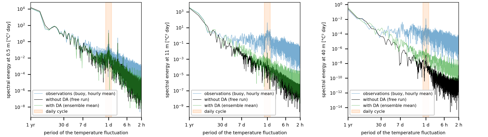{ width="880" .center }
/// figure-caption
Upper Lugano 2025, `simplified_final`: spectral energy of hourly temperature by depth and period, without and with DA and their ratio (top); spectra at 0.5, 11 and 40 m with the observations (middle); spectra of the model − observation error (bottom).
///

**Result so far:** The assimilated run keeps generally the spectral shape of the free run at every depth (Figure 19), so the model's natural behaviour is preserved. At short periods (days to hours) and at 11 and 40 m, the energy with assimilation lies between the free run and the observations: it moves towards the real lake, which has far more short-period energy than the 1D model. 

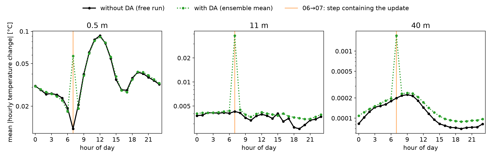{ width="880" .center }
/// figure-caption
Upper Lugano 2025, `simplified_final`: mean absolute hourly temperature change by hour of day at 0.5, 11 and 40 m, without and with DA; the update falls in the 06 → 07 UTC step.
///

Each update is a single step (Figure 20, the 06 → 07 UTC hour), with no oscillation after it; in every other hour the assimilated run changes like the free run.

**Next step:** Results support the claim in [Overview](overview.md) that the shocks are not generating artificial oscillations and that the scheme is safe to run unattended.

**Reproduce:** Not in the repository; scripts available from the author on request.

### Oxygen assimilation { #to2-profiler }

**Status:** (✅) Positive, potentially to be adopted · **Lakes:** Ägeri (Nov 2022 – Jun 2026), Murten (Jun 2022 – Jun 2026)

**Question:** Can the same filter correct dissolved oxygen as well as temperature, and what does the vertical coverage of the oxygen data change?

**Setup:** Temperature and oxygen are assimilated together, with their updates decoupled (temperature observations correct only temperature, oxygen only oxygen), a seasonal σ for oxygen, and a small white noise (standard deviation 2 mmol/m³) on every member's oxygen after each analysis, to widen an oxygen spread that was far below its innovations. Here the profilers are assimilated and the CTD casts are only used for scoring; the next two experiments change which data go in:

| Data | Ägeri | Murten |
|---|---|---|
| Profiler, temperature | 23 depths, 2–79 m | 35 depths, 0.5–43 m |
| Profiler, oxygen | 23 depths, 2–79 m | 3 depths: 25, 40 and 41 m |
| Profiler period, as assimilated | Nov 2022 – Oct 2026, seiche-filtered, one profile a day at 23 UTC | Jun 2022 – Jul 2026 (oxygen from Dec 2022), seiche-filtered, one profile a day at 04 UTC |
| CTD casts (T and O₂) | 14 casts, about quarterly, Dec 2022 – Mar 2026, 0.5–78.5 m | 42 casts, about monthly, Jul 2022 – Dec 2025, 0.5–42.5 m |
| [Oxygen assimilation](#to2-profiler) | profiler in, casts for scoring | profiler in, casts for scoring |
| [Depth thinning](#depth-thinning) | 5 of the 23 profiler depths in, all profiler depths and casts for scoring | – |
| [CTD interpolation](#ctd-interpolation) | casts in, profiler for scoring | casts in, profiler for scoring |

Ägeri's profiler is high-resolution both in time and in depth; Murten's is high-resolution in time, but measures oxygen only in the deep water.

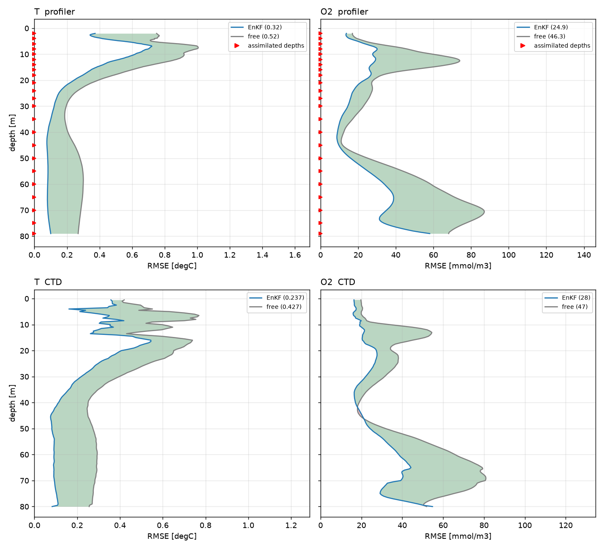{ width="700" .center }
/// figure-caption
Ägeri, Nov 2022 – Jun 2026, profiler assimilated: RMSE profiles of T and O₂, free run vs EnKF, against the profiler (top) and the CTD casts (bottom).
///

**Result so far.**

- **Ägeri: large improvement (Figure 21):** O₂ error against the profiler drops by about 45 % (46 → 25 mmol/m³), and is spread more evenly over the column, with large gains at 10–20 m and again in the deep water, but not directly at the lake bed. Temperature 0.52 → 0.32 °C.
- **Murten: smaller improvement (Figure 22):** O₂ drops by about 18 % against the CTD casts (69 → 57 mmol/m³), mostly at the deeper levels near the three oxygen sensors. Temperature 0.79 → 0.45 °C against the profiler.

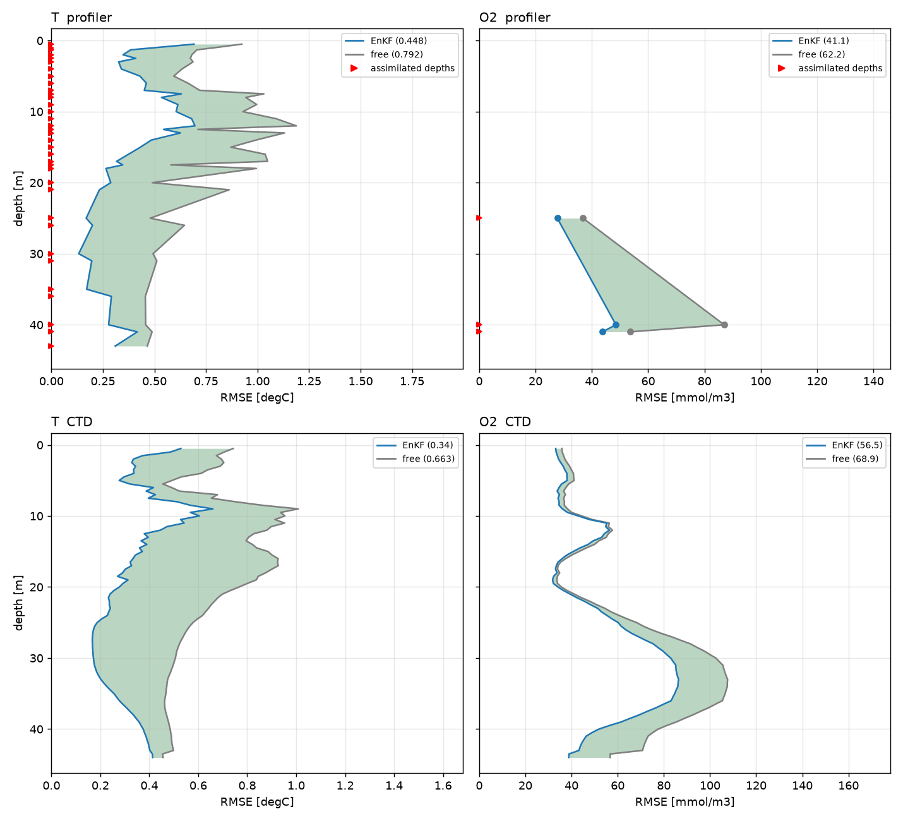{ width="700" .center }
/// figure-caption
Murten, Jun 2022 – Jun 2026, profiler assimilated: RMSE profiles of T and O₂, free run vs EnKF, against the profiler (top) and the CTD casts (bottom).
///

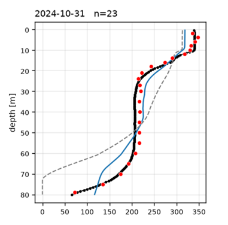{ width="320" .center }
/// figure-caption
Ägeri, 31 October 2024: O₂ profile, observations (red), free run (dashed) and EnKF (blue).
///

The filter struggles right above the lake bed. In the example of Figure 23 the assimilated profile (blue) fits the observations (red) as well as it can, but keeps the wrong shape at the bottom. This points to a structural model error: the model cannot simulate the oxygen depletion at the bottom boundary.

**Verdict so far:** Vertical coverage matters, and the bottom boundary has to be fixed in the model, not by assimilation.

**Reproduce:** Not in the repository; scripts available from the author on request.

### Observation depth thinning { #depth-thinning }

**Status:** (✅) Positive, potentially to be adopted · **Lakes:** Ägeri

**Question:** How many depths do we need for a useful improvement? If the filter can interpolate vertically, fewer sensors could be enough in the field.

**Setup:** Same Ägeri profiler data as above, temperature and oxygen, but keep only 5 of the 23 depths (2, 10, 20, 40, 70 m; a second layout 2, 7, 15, 45, 70 m) and score against all profiler depths and hours, with the 23-depth run as reference.

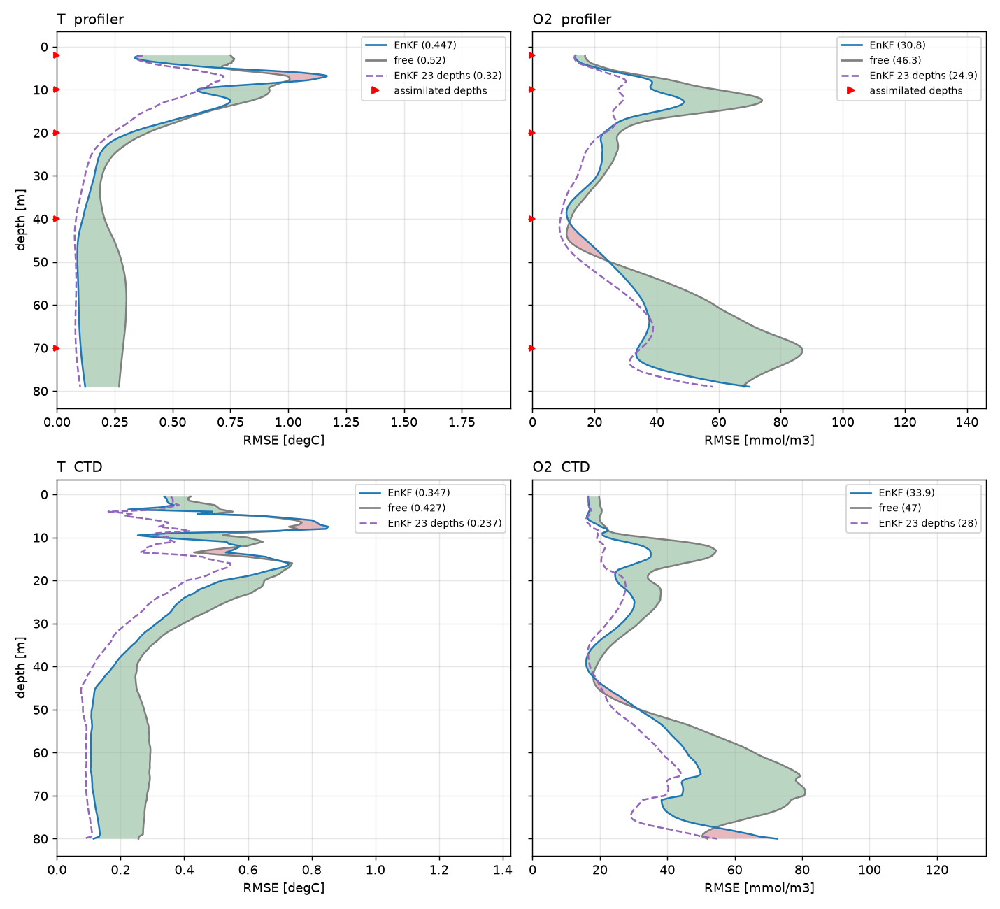{ width="700" .center }
/// figure-caption
Ägeri: RMSE profiles with 5 assimilated depths (blue) vs 23 (dashed) vs free run; red fill where 5 depths are worse than the free run.
///

**Result so far:** With 5 depths, about 35–40 % of the temperature gain (0.52 → 0.45 °C, against 0.32 with 23 depths) and about 70 % of the oxygen gain (46 → 31 mmol/m³, against 25) remain. These are scored on the profiler, of which the 5-depth run assimilates a few depths; against the CTD casts, which neither run assimilates, the shares are almost the same (about 40 % for temperature, 0.43 → 0.35 °C against 0.24; about 70 % for oxygen, 47 → 34 mmol/m³ against 28). The deep levels above the bottom keep good gains with just a few measurements; the rest to a lower extent. Each layout opens possible new gaps between its sensors (red areas in Figure 24, where the filter is worse than the free run) and the oxygen and temperature structure of each lake needs to carefully be taken into account and requires more study.

**Reproduce:** Not in the repository; scripts available from the author on request.

### CTD casts as a temporal interpolator { #ctd-interpolation }

**Status:** (✅) Positive, potentially to be adopted · **Lakes:** Ägeri, Murten

**Question:** Many lakes have only monthly or quarterly CTD casts. With only those assimilated, does the run give realistic profiles *between* the casts?

**Setup:** Assimilate the CTD casts (T and O₂) instead of the profiler: 14 casts on Ägeri, 42 on Murten (see the [data table](#to2-profiler)); the high-resolution profiler, never seen by the filter, becomes an independent check of the interpolation in time. Note the rows in Figures 25 and 26 are swapped with respect to the profiler runs: top row = independent profiler, bottom row = the assimilated casts, one hour after the analysis.

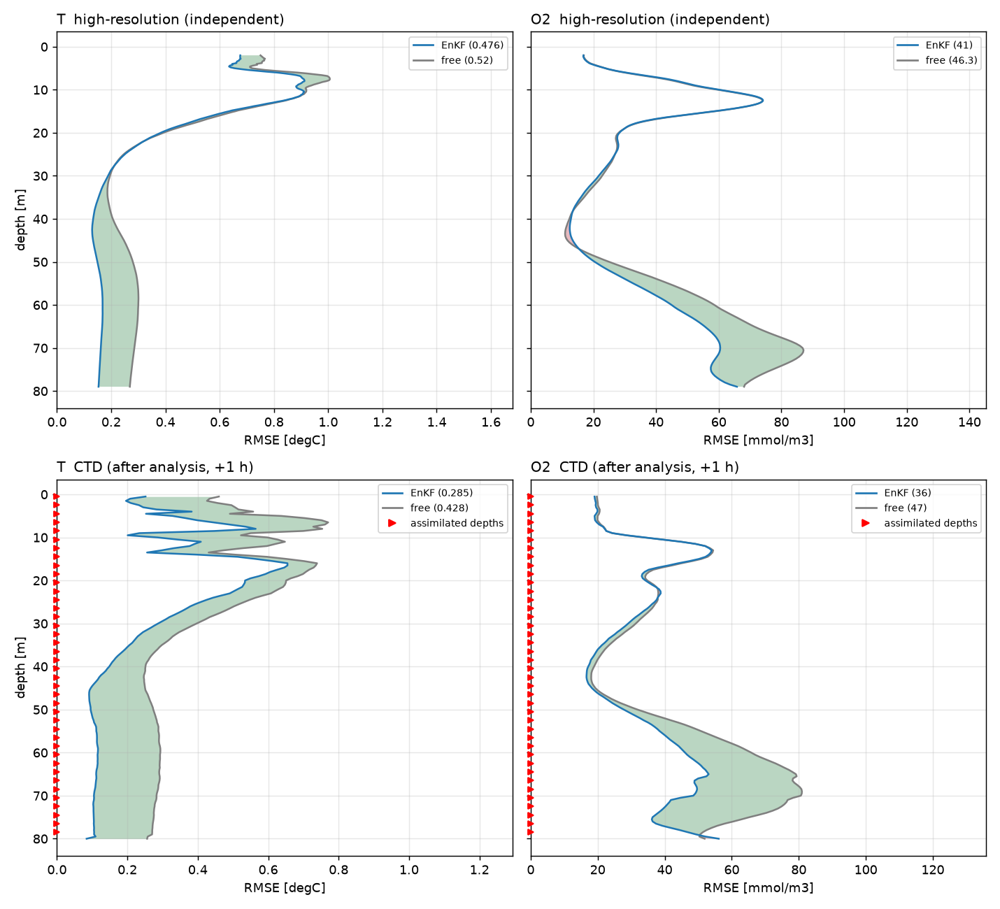{ width="700" .center }
/// figure-caption
Ägeri, CTD casts assimilated: RMSE profiles against the independent profiler (top) and the casts, one hour after the analysis (bottom).
///

**Result so far:**

- **Ägeri: it works essentially only in the deep water:** Between casts, O₂ at 50–80 m stays closer to the profiler than the free run; above about 40 m it is no better than the free run. Overall about −10 % (O₂ 46 → 41 mmol/m³, T 0.52 → 0.48 °C), not evenly distributed.
- **Murten: similar (Figure 26).** Gains where observations are available (O₂ 62 → 53 mmol/m³, T 0.79 → 0.65 °C). Here we would have expected oxygen gains up to about 15 m.

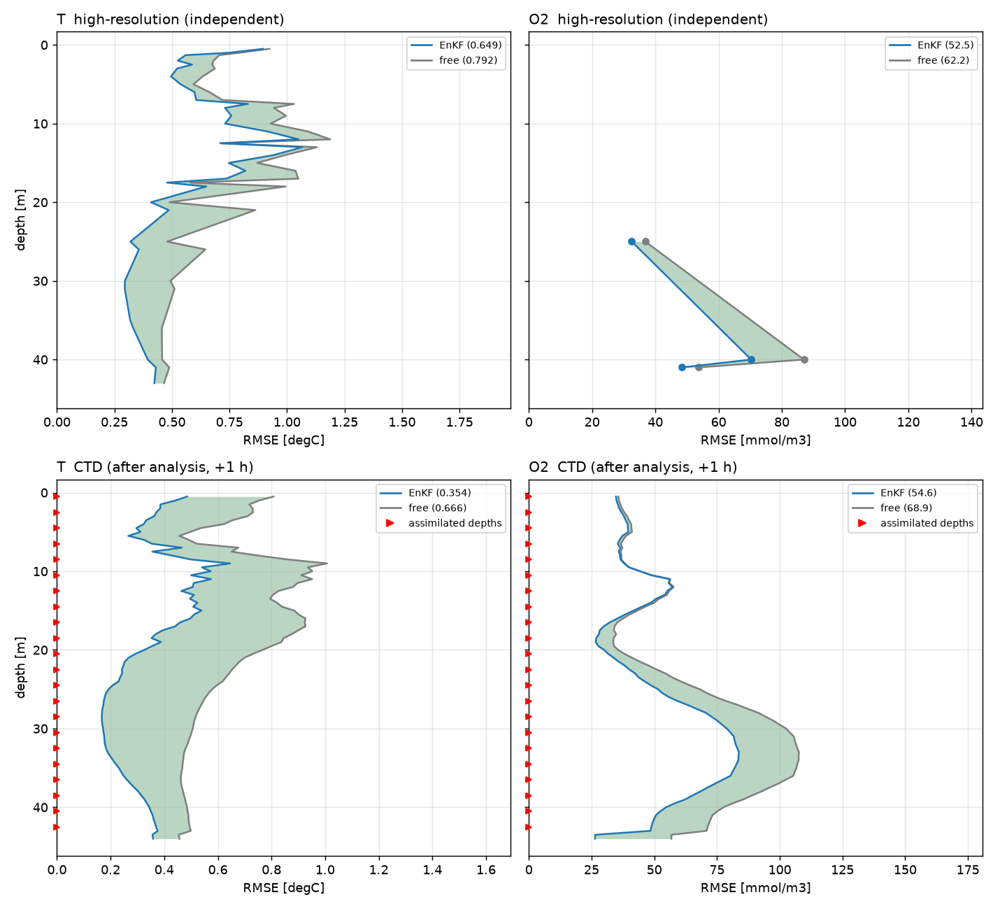{ width="700" .center }
/// figure-caption
Murten, CTD casts assimilated: RMSE profiles against the independent profiler (top) and the casts, one hour after the analysis (bottom).
///

These runs need the forcing ensemble centred on the original forcing, because the observations are weeks apart ([Centred forcing perturbations](#centred-forcing)).

**Verdict so far:** Assimilation is a promising temporal interpolator for the deep layers, but not for the faster-varying upper layers with monthly or sub-monthly sampling.

**Reproduce:** Not in the repository; scripts available from the author on request.

### Centred forcing perturbations { #centred-forcing }

**Status:** (✅) Positive, potentially to be adopted · **Lakes:** Ägeri, Murten, Geneva

**Question:** Does the forcing perturbation shift the ensemble mean away from the original forcing, and does that matter?

**Setup:** The AR(1) noise is added to the wind components U and V with zero mean. But the wind *speed* is the length of the vector, so noise in either direction makes it larger on average. With the option `center_perturbations`, each forcing row is rescaled so that the ensemble-mean wind speed, solar radiation and air temperature equal the unperturbed forcing.

**Result so far:** Without centring, every member is windier than the control: the ensemble-mean wind speed is 63 % above it on Ägeri (2.52 against 1.55 m/s), 57 % on Geneva and 31 % on Murten. With centring, the two agree to within about 2 %. With daily assimilation the filter corrects the resulting bias every day, but when the observations are weeks apart (CTD casts) it accumulates between casts: more wind, more mixing, a deeper overturn. That may explain part of the more frequent deep mixing seen on Lake Lugano ([Deep mixing](#deep-mixing)).

**Next step:** The operational setup (`simplified_final`) runs without centring, so check its effect there too, and repeat the Lugano deep-mixing run with centred forcing.

**Reproduce:** Branch `feat/online_error`, option `center_perturbations`.

### Long-term CTD assimilation in Geneva { #geneva-ctd }

**Status:** 🔬 Open · **Lakes:** Geneva (LéXPLORE casts, Nov 2019 – Jun 2026)

!!! abstract "In short"
    - **The casts correct both variables well.** Temperature RMSE against the profiler 1.19 → 0.87 °C; oxygen RMSE at the casts 105 → 38 mmol/m³.
    - **Winter remains wrong, and neither tuning knob fixes it.** More forcing noise or a smaller winter σ leave the errors unchanged: the model mixes too deep in winter, in every member alike.

**Question:** Can six and a half years of CTD casts correct temperature and oxygen together, and does the result hold against the high-resolution profiler, which is not assimilated?

**Main result (annual σ 0.297 °C):**

| RMSE | Free run | EnKF |
|---|---|---|
| Temperature, against the profiler | 1.19 °C | 0.87 °C |
| Oxygen, at the casts | 105 mmol/m³ | 38 mmol/m³ |

- **Oxygen:** the free run's deep water is about 120 mmol/m³ too low below 40 m. The filter needs about a year to lift it (NIS/n about 20 at the start, about 1 from 2022 to 2025).
- **The ensemble is far too narrow:** spread 0.026 °C against σ 0.297 °C, so all the uncertainty sits in σ.

**Two attempts to improve winter, neither helped:**

1. **Perturb air temperature too** (AR(1), sd 1.67 °C): the winter spread stays around 0.03 °C, because the deep mixed layer damps the noise.
2. **A smaller winter σ** (0.10 °C from November to April, the scatter of same-day double casts):
    - Too small: winter NIS/n (December–March) goes from 0.73 to 4.95. The double-cast scatter measures the casts, not what the model cannot represent; the innovations point to about 0.25 °C, close to the annual value.
    - No accuracy gain: temperature RMSE is unchanged (0.864 against 0.865 °C), oxygen RMSE 38 → 40 mmol/m³, and the winter mixed layer stays about 15 m too deep (error about 22 m).
    - Why: the stronger updates halve the already tiny spread (0.028 → 0.014 °C), and the model drifts back between casts, so each cast meets the same misfit.

**Deep mixing, year by year:** The casts mix to the station bottom (about 100 m) only in 2020, 2021 and 2026. The model reaches the bottom almost every winter, with or without assimilation; in 2022 and 2024 the lake stopped at about 65 m and 45 m. Unlike on Lake Lugano, assimilation does not make deep mixing more frequent: over the full 309 m column the free run overturns completely in 2021 and 2022, the EnKF only in 2022.

**Verdict so far:** The remaining error is a systematic winter model error (mixing too deep, surface too cold, the same in every member), not a filter-tuning problem ([Open problems](open-problems.md)).

**Next step:** Most of the 0.25 °C winter σ is model uncertainty that the ensemble does not carry. A process noise on the temperature profile, as in the [learned R and q](#uncertainty-band), would move it into the ensemble, so σ could shrink towards the cast scatter and each cast would correct more. In a near-isothermal winter column the noise must not create inversions (the profile constraint discussed there).

**Reproduce:** Not in the repository; scripts available from the author on request.
