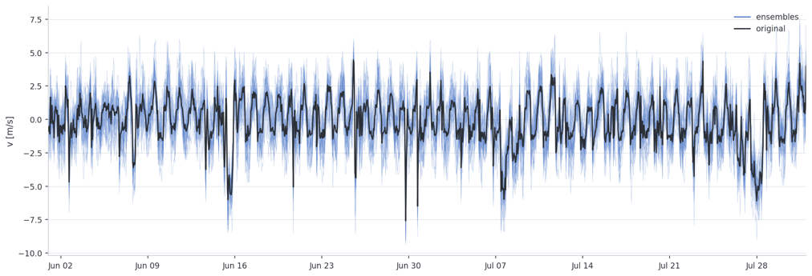
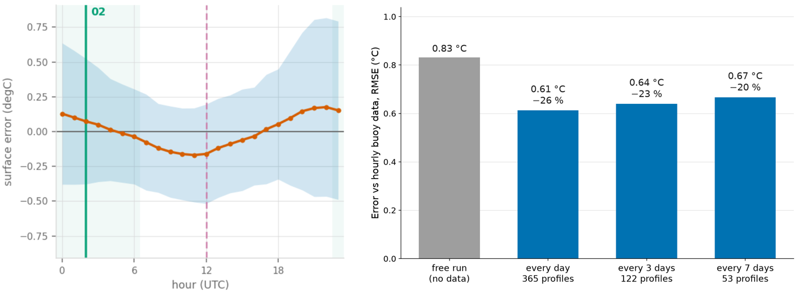
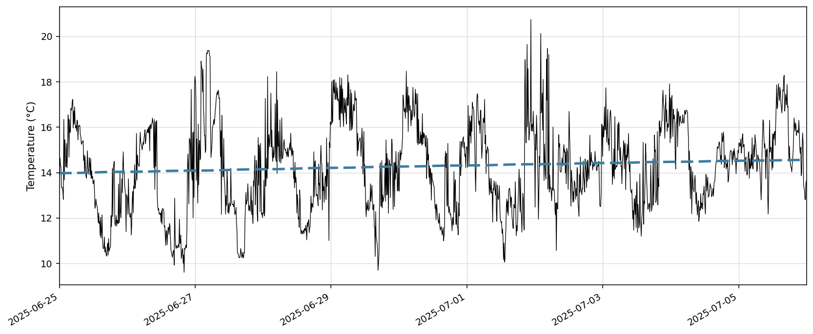
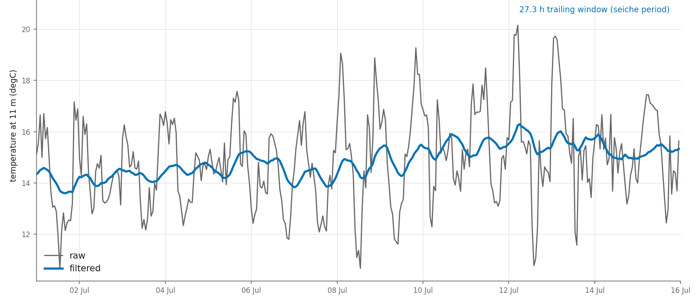
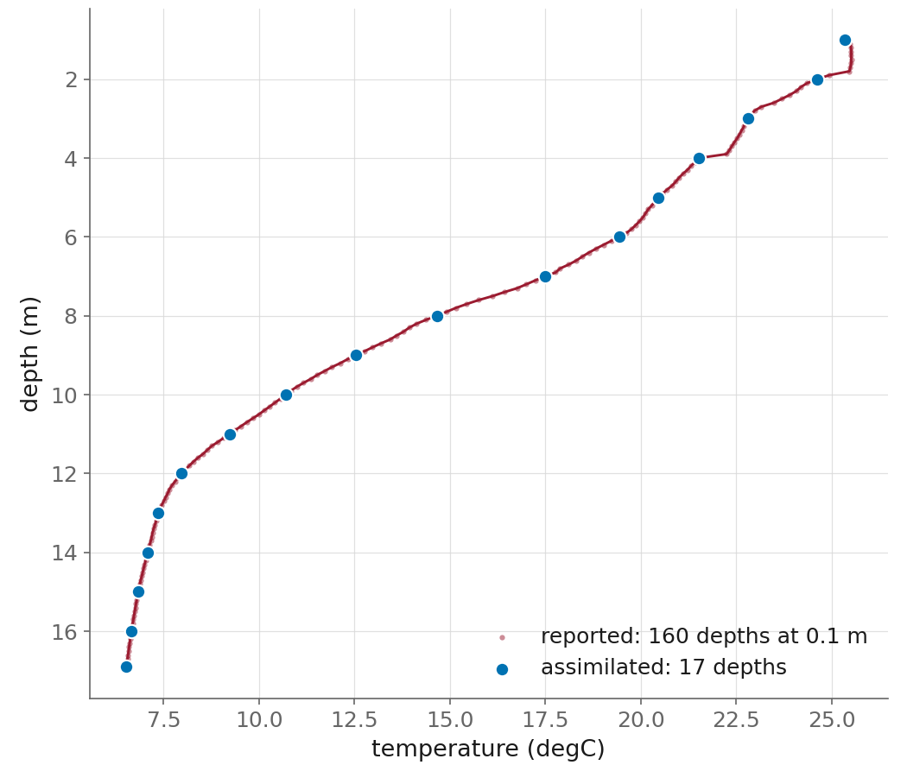

# Method

*Last updated: October 2026.*

!!! abstract "In short"
    A 20-member ensemble is made by adding AR(1) noise to wind and solar radiation. Once a day, at a per-lake night hour, a stochastic EnKF corrects the temperature profile of every member. The observations are filtered below 4 m to remove internal-seiche motion the 1D model cannot reproduce, and thinned to a per-lake depth grid. Their uncertainty σ is a representativeness error, not instrument error: one value per lake and season.

## The filters { #filters }

The **Ensemble Kalman Filter (EnKF)** updates the state by weighing two uncertainties against each other: how wrong the ensemble thinks the model is, and how wrong we say the observation is. The Kalman gain can be read as a trust ratio: if the ensemble is confident, the observation moves the state very little; if the ensemble is uncertain, the observation wins and pulls the state a lot. The property that makes this filter attractive for a lake column is that information propagates in depth through the ensemble covariance, which comes from the model spread and so reflects the model physics: an observation at one depth can correct the whole profile, by an amount the ensemble says those depths move together (and, in a 3D model, this also translates to whole regions of the lake). We use the *stochastic* EnKF: where each member is updated with its own perturbed observation, to avoid ensemble collapse.

The **Particle Filter (PF)**, on the other hand, never builds a correction. It re-weights and clones whole member states in proportion to their likelihood, so every surviving trajectory stays a physically untouched Simstrat run. The price is that the analysis can only ever contain states the model itself produced: if no member happens to have the right profile, there is no mechanism to produce a fitting one and potentially would need more spread (ensemble members) or more effort in creating varying particles (parameter sampling).

The native engine also has a cheaper **best-member selection**, which clones the best-fitting member onto all the others as a simple reference ([details](#selection)).

> **Why an ensemble filter and not a standard Kalman filter?** The models are nonlinear, which a classic KF handles poorly. An ensemble method treats the model as a black box, so the same strategy transfers to other models well (see [3D](experiments.md#3d)); it needs no derivatives to build the error covariances; and the members run naturally in parallel.

!!! note "Decision: the EnKF is the operational filter"

    - **Alternatives:** particle filter (OpenDA), best-member selection (native).
    - **Evidence:** the EnKF wins on every lake, on both engines; selection is worse than no assimilation on three lakes ([Results](results.md#which-filter)).
    - **Revisit if:** the ensemble becomes much larger, or the spread at depth grows enough that members genuinely differ there too; that is where the PF fails now.

## Where the spread comes from { #spread }

You cannot run an ensemble filter without spread, and the spread has to come from a defensible source. We generate it by perturbing the meteorological forcing, a major and well-known uncertainty factor for lake models. **This forcing perturbation is the only component that generates spread in the module right now.**

{ width="880" .center }
/// figure-caption
Ensemble envelope (blue) around the control station forcing (black), one wind component, Lake Lugano, July 2025.
///

Figure 1 shows a blue ensemble envelope around the black control station forcing, here for one wind component on Lake Lugano during July 2025.

**Only three variables are perturbed: wind U, wind V, solar radiation.** Temperature, vapour pressure, cloud cover and rain pass through untouched. Those three dominate the surface momentum and energy budget, and restricting to them keeps the mechanism simpler and potentially more interpretable.

Each member gets one AR(1) noise series added to the control forcing, so that the perturbation carries part of the temporal correlation of real forcing errors:

```
xₜ = φ·xₜ₋₁ + σ·εₜ ,      ε ~ N(0,1)
```

We assume that the **amplitude** of the perturbation represents the mismatch between the lake's reference meteorological station and the average conditions over the lake, and measure it as the standard deviation of the ICON reanalysis averaged over the lake minus the control forcing, `s = std(ICON − control)`. The **persistence** `φ = exp(−1/τ)` cannot be measured precisely: we bracket it between two proxies, the autocorrelation of the residual series and of the station signal itself, and take the end that gives *more* persistence, hence potentially more spread, which benefits the EnKF. The size of one hourly kick then follows as `σ = s·√(1−φ²)`. The full calibration is in [Perturbation calibration](#perturbation-calibration).

The practical advantage is that **the ensemble is generated at the forcing, not at the state.** Members diverge the way the weather diverges, and each one remains a physically consistent Simstrat run. This is done to keep the filter from shocking the model when it injects a correction.

!!! note "Decision: spread from forcing perturbation only"

    - **Alternatives:** parameter perturbation, joint state–parameter estimation, state perturbation ([Experiments](experiments.md#model-spread)); not tested, driving each member with a member of an NWP ensemble (COSMO-E), as [Safin et al. (2022)](../literature-review.md#safin-2022) do for Lake Geneva, which keeps the physical correlations between variables without a statistical noise model.
    - **Evidence:** keeps every member a physically consistent run and the corrections small; the defensible parameter perturbations added only little spread.
    - **Revisit if:** a defensible source of spread at depth is found, e.g. the process noise of the [forecast uncertainty band](experiments.md#uncertainty-band), or parameter spread at longer analysis intervals ([Parameter perturbation](experiments.md#param-perturbation)); under-dispersion is the main open problem ([Open problems](open-problems.md)). The forcing ensemble is also not centred yet ([Open problems](open-problems.md#uncentred-forcing)).

## When to assimilate { #timing }

{ width="800" .center }
/// figure-caption
Choosing the assimilation hour. Left: bias and random error of the free run by hour of day, Lake Geneva. Right: RMSE by assimilation frequency, Upper Lugano 2025.
///

The left panel of Figure 2 shows how the bias and random error are distributed over the day for Lake Geneva. The right one shows how the accuracy of the assimilation decreases with decreasing frequency for Lake Lugano.

**Daily:** A daily frequency reduces the error correlation between successive analyses, and avoids a sub-daily reversal of the error sign eating into the potential gains. Assimilating more often would make the filter less efficient (information counted twice) and noisier (potential reversals of the corrections). Going below daily costs accuracy ([Assimilation frequency](experiments.md#frequency)). This agrees with [Wander et al. (2024)](../literature-review.md#wander-2024), who found daily assimilation the most skilful for a 1-day forecast, but weekly assimilation the most skilful for 8–35-day horizons.

**At a specific hour:** Using a free run, we take the mean and standard deviation of the model–observation error over the days, hour by hour, and pick the hour that maximises the random (correctable) error per amount of bias injected. The reasoning: the deterministic part of the gap is potentially a correction for something the model's physics might undo.

Only the **surface layer, above 4 m,** enters this choice. That is where the diurnal cycle lives, and so where the hour makes a bigger difference. Below 4 m the observations go through the seiche filter, whose trailing window (11 h or more, depending on the lake) smooths most of the diurnal signal out: there the hour matters much less.

By this measure **noon, the hour used by the current BETA, turns out to be a bad choice.** The exact rule is in the [Tutorial](../tutorial.md).

**At night:** Candidates are restricted to 23–06 UTC, so that every lake is sampled at a comparable point in its diurnal cycle, with the operational bonus that it is off-hours.

Only hours the lake actually samples are candidates, with adaptation where a fixed frequency cannot be guaranteed (Greifensee takes the first reading between 00 and 06 UTC each day). Days without a profile in the window are skipped. The hour picked for each lake is in the [per-lake card](reference.md#lakes).

!!! note "Decision: daily, at a per-lake night hour"

    - **Alternatives:** every 3 or 7 days; noon (the BETA); any hour of the day.
    - **Evidence:** daily beats 3- and 7-day on Upper Lugano ([Assimilation frequency](experiments.md#frequency)); noon maximises injected bias.
    - **Revisit if:** more model spread makes lower frequencies competitive (with `p_lw` ±10 %, assimilating every 3 days already matches the daily accuracy: [Parameter perturbation](experiments.md#param-perturbation)), or a lake's sampling schedule changes.

## The observations { #observations }

### The raw signal at depth is not the signal we can use

{ width="800" .center }
/// figure-caption
Raw temperature at 11 m against the model, Upper Lugano, 25 June to 5 July 2025.
///

Figure 3 shows a raw temperature observation at 11 m depth, 25 June to 5 July 2025, Upper Lake Lugano. The sensor swings by up to **10 °C within a few hours**. The dashed line is what Simstrat predicts at the same times, and it is nearly flat, with only an underlying trend visible. (The series is debiased here to make the contrast more visible.)

The cause is internal wave motion: the steep thermal gradient is displaced vertically past a fixed instrument. The sensor is right and the signal is real.

But **a 1D model cannot reproduce it by construction**. There is no horizontal dimension for an internal wave to propagate in. So this variability, which can exceed the entire actual model–observation discrepancy we are trying to correct, is not an error the filter should try to fix. Feeding these thermocline-displacement excursions to the filter would continuously drag the whole column toward an unstable state that the model cannot maintain.

### Filtering the observations causally

{ width="800" .center }
/// figure-caption
Causal filtering of the observations at 11 m, Upper Lugano: hourly series (black) and filtered series (blue).
///

Figure 4 shows the original time series of the temperature at 11 m in Upper Lugano in black (already aggregated to hourly) and, in blue, the observation filtered with a 27.3 h trailing window set by the seiche period. The fix is to remove large part of the signal the model cannot represent. Three constraints shape the solution:

- **It must be causal:** no leakage of future information, because this runs operationally (a centred moving average would be better but not useable). We use a trailing moving average.
- **It must be split in depth:** above a threshold (currently 4 m) the series passes through untouched. Surface temperature does not suffer thermocline displacement in the same way, and we do not want to blur an important fast signal.
- **It must be set physically, per lake:** the trailing window comes from a two-layer approximation, using the lake length and its stratification at peak, giving a characteristic fundamental internal-seiche period for each basin ([per-lake card](reference.md#lakes)).

Residual variability at depth drops from around 10 °C to roughly **1–1.5 °C**. Still not small, but far more digestible for the filter. What the filtering gains is shown in [Observation filtering](experiments.md#filtering).

### Too many sensors

{ width="380" .center }
/// figure-caption
Thinning a dense sensor chain to the target depth grid.
///

Profilers and moorings differ in vertical and temporal resolution, and a filter that ingests whatever it is handed behaves differently on each. Some instruments, such as those on Ägeri and Greifensee, report at sub-metre resolution (Figure 5: 160 depths at 0.1 m). **Neighbouring sensors at that spacing are near-copies**: two thermistors 10–25 cm apart in a well-mixed layer report the same water, and their error is essentially one error, not two independent ones. The filter counts them as independent evidence and can grow over-confident, pull too hard toward the observations and shrink the posterior spread. With only 20 members, ensemble collapse is something we want to avoid as much as possible.

The solution is a per-lake **target vertical grid**: dense profiles are thinned to a manageable resolution (here 17 assimilated depths), preferring the depths with fewer gaps. That also makes the seven lakes more comparable with each other. The large observation uncertainty defined below further counteracts the residual over-confidence.

## The observation error σ { #sigma }

### σ is not instrument error

The unrepresented variability is still present in smaller magnitude at filtered depths but *also at unfiltered depths*, and this mismatch cannot easily be covered by spread generated through forcing perturbation alone: we are asking the ensemble to cover variability that no member could produce with the current setup.

The sensors are generally very accurate; their precision is not the issue. So the uncertainty we hand the filter has to come from somewhere else, or the filter will pull far too hard toward the observations. We therefore define σ **not as instrument error but as representativeness error**: an honest statement of what the model cannot reproduce and is currently assigned as observation error. It varies by lake, by depth, and by season. That is partly process: variability, like the internal-wave signal above, that a 1D column cannot reproduce. And it is partly space: a buoy measures one point, while Simstrat represents a horizontally averaged column for the whole lake.

### A simple operational recipe

For the operational setup we make three deliberate simplifying assumptions: the observation uncertainty is **fixed in depth**, **seasonal** (mixed vs stratified), and **comparable from year to year**.

**The recipe:** take the gap between a free run and the filtered observations at the assimilation times over a reference year (for the results presented here, 2025 for data availability over an entire year for all lakes). Split the series into seasons and remove each season's own mean (that is bias, not random uncertainty). Take the standard deviation of what remains as a variability proxy, and aggregate with the median across depths. This is deliberately a simple approach aimed at being a justified and generalizable approach to start running the multiple lakes operationally.

| season | upperlugano | maggiore | greifensee | geneva | aegeri | hallwil | murten |
|---|---|---|---|---|---|---|---|
| **mixed** | 0.30 | 0.70 | 0.52 | 0.28 | 0.24 | 0.41 | 0.34 |
| **stratified** | 0.59 | 1.17 | 0.94 | 0.59 | 0.24 | 0.39 | 0.60 |

The stratified season generally wants a larger σ, exactly what you expect if the dominant error source is thermocline displacement. Two lakes break the pattern: Ägeri, which we restrict to a single scalar because the seasonal split performed worse, and Hallwil, whose mixed season is marginally *larger* than its stratified one and represents an odd case.

> σ here is the honest statement of what the model cannot reproduce. The uncomfortable part is that it still occupies essentially the whole uncertainty budget (the ensemble remains too narrow and model uncertainity underrepresented).

### Why the seasonal σ stays operational, for now

We tested three alternatives: σ resolved in depth, rescaled against the filter's own innovations, and estimated on the fly from the innovations ([Experiments](experiments.md#sigma)). Each calibrates better than the seasonal σ. None of them is clearly more accurate. For an unattended system, three things tip the balance.

**Simple.** The seasonal σ is two numbers per lake, fitted once and written in the config. Anyone can read them, both engines use them unchanged, and the filter's trust is known before the run starts. The adaptive σ is a moving quantity. It needs a two-week history of innovations that must survive restarts and outages.

**Cautious.** The approaches fail in opposite directions, and only one of those directions is safe. The seasonal σ is too large (NIS ≈ 0.6), so the filter under-trusts the observations and corrections stay generally small. The adaptive σ can fall significantly and might pull hard where it has little information about its own error. A sudden change after a quiet fortnight, whether a real event or a faulty sensor, is over-trusted until the window catches up. And because σ is estimated from innovations the filter itself shaped, errors can reinforce themselves in both directions. Good corrections shrink the innovations, which shrinks σ, so the filter pulls harder. A growing model bias enlarges them, which raises σ, so the filter lets go. On Ägeri the second loop took more than half the gain ([Adaptive σ](experiments.md#adaptive-sigma)). The seasonal σ is measured against a free run the filter never touched, so it cannot enter either loop.

**Differences.** What do we give up? In general accuracy, nothing: the seasonal σ is as good or better on six of seven lakes, and Upper Lugano's advantage for the adaptive σ did not carry over to the other lakes. What we give up is an honest uncertainty: the seasonal filter often says it is less sure than it really is and it trusts the observations less than it could.

!!! note "Decision: fixed seasonal σ per lake"

    - **Alternatives:** depth-resolved σ, rescaled σ, adaptive σ ([Experiments](experiments.md#sigma)).
    - **Evidence:** as accurate or better on six of seven lakes, cannot enter a feedback loop, and the choice of fitting year barely matters ([Fitting year](experiments.md#fitting-year)).
    - **Revisit if:** the ensemble spread at depth grows (σ would no longer have to fill the whole budget), the capped adaptive σ proves itself ([Open problems](open-problems.md#over-cautious)), or an observation file changes: σ is only valid for the file it was fitted on.

---

## Details & Math 

### The EnKF in full { #enkf-full }

Two quantities are computed from the ensemble spread:

```
PHᵀ  ≈  Aᶠ (HAᶠ)ᵀ / (N−1)          how the whole column co-varies with the measured depths
HPHᵀ ≈  (HAᶠ)(HAᶠ)ᵀ / (N−1)        the forecast's own spread at the observed locations
```

The first is the one that matters most for a 1D lake column: it is what lets an observation at 5 m adjust the temperature at 12 m, because the ensemble says those depths move together. The gain then weighs the two uncertainties,

```
K  =  PHᵀ (HPHᵀ + R)⁻¹
```

and each member is updated with **its own perturbed observation**,

```
xᵢᵃ  =  xᵢᶠ + K (dᵢ + εᵢ) ,      εᵢ ~ N(0, R)
```

which helps prevent ensemble collapse, i.e. the spread shrinking to nothing and the filter ceasing to listen to the observations at all.

| symbol | meaning |
|---|---|
| N | ensemble size |
| A | ensemble spread about the mean |
| P | forecast error covariance |
| R | observation error covariance |
| K | Kalman gain |
| H | observation operator |
| X | state vector (forecast / analysis) |
| dᵢ | *innovation* = observation − member forecast |
| εᵢ | observation perturbation drawn for member i |

The structure of K explains the entire calibration effort in [Results](results.md#honest) and [Experiments](experiments.md#sigma): it is essentially **model spread / (model spread + observation error)**. If R is too small the filter believes the observations completely and pushes the model around. If R is too large you pay for an ensemble that corrects very little and ends up reproducing a free run. There is no neutral choice; it is always a balance.

> **R is diagonal.** Each observation gets its own variance σ² on the diagonal, and every off-diagonal term is zero: `R = diag(σ²)`, in both engines. In other words, the observation errors are assumed independent of each other, and the σ described [above](#sigma) is the whole of R. This is a simplification: neighbouring depths share part of their representativeness error (e.g. the same internal wave moves the whole thermocline), so their errors are in reality correlated. We keep it diagonal because those correlations are difficult to estimate reliably from the data (and estimating them wrong could do more damage than good); because the setup already compensates for them in two ways (profiles are thinned so that near-duplicate sensors are not counted twice ([Too many sensors](#observations)), and σ is deliberately large); and because OpenDA's standard observers, including the one we use, only take one standard deviation per observation: the OpenDA EnKF itself accepts a full R, but providing one would need a custom observer.

### The PF (OpenDA) { #pf-full }

A SIR particle filter with residual resampling. Each member is weighted by the Gaussian likelihood of its own innovation,

```
wᵢ  ∝  exp( −½ · dᵢᵀ R⁻¹ dᵢ ) ,      w̃ᵢ = wᵢ / Σⱼ wⱼ ,      Σᵢ w̃ᵢ = 1
```

after which members are resampled so each is duplicated roughly in proportion to `w̃ᵢ`. Copies are exact clones of the full model state.

Note what does *not* appear: no gain, no covariance, no `PHᵀ`. The PF never asks how the column co-varies. It cannot use an observation at 5 m to construct a correction at 12 m; it can only prefer members that already happened to be right at both.

**This is the weak point at our ensemble size.** With 20 members and a state vector spanning every depth cell, the likelihood is sharply peaked: a few members can dominate, the filter can collapse to a single particle, resampling fills the ensemble with copies of one trajectory, and the spread is almost all gone until the following day's forcing perturbations rebuild it. That is the well-known dimensionality limitation of particle filters, and it is why the EnKF is the operational choice.

### The native engine's "PF" is a selection scheme { #selection }

The native engine scores each member by a depth-weighted RMSE over the window (hourly data),

```
RMSEᵢ = sqrt( Σ_z w_z (xᵢ(z) − y(z))² / Σ_z w_z )
```

with trapezoidal layer thicknesses as weights `w_z`, so a tight cluster of sensors does not outvote a sparsely instrumented part of the column. The filter then clones the best member onto all the others. In the language above, that is a particle filter whose weights have been replaced by a hard `argmin`:

```
w̃ᵢ = 1 for the single best member, 0 otherwise
```

It sits permanently at the degeneracy the real PF only falls into occasionally. It is *best-member selection*, not Bayesian inference, and it is kept as a cheap reference rather than a competitor. The "Selection" column in [Results](results.md#which-filter) is this scheme; the "PF (OpenDA)" column is the real SIR filter.

### Perturbation calibration { #perturbation-calibration }

Each member gets one AR(1) noise series per variable added to the control `Forcing.dat`:

```
xₜ = φ·xₜ₋₁ + σ·εₜ ,      ε ~ N(0,1) ,      φ = exp(−1/τ)
```

The two parameters are fitted from **different data and kept strictly separate**.

**Amplitude: measured.** The stationary standard deviation `σ/√(1−φ²)` is fitted from the ICON residual, `s = std(ICON lake mean − control Forcing.dat)`: how far the reanalysis actually strays from the control forcing. Fitted once per lake and committed. This stands for a realistic representativness error of the original station forcing.  

**Persistence: bracketed, not measured.** No dataset gives us the decorrelation time of the *forcing forecast error*, so we bracket it between two proxies, each biased in a known direction:

- *Floor*: the ACF of the ICON residual. An approximation of the error ACF after averaging; its 1/e crossing comes early.
- *Ceiling*: the ACF of the station signal itself. This measures how long the *weather* persists, not how long the *error* does. A forecast already captures the slow synoptic structure and fails on the fast small-scale part, so the error is enriched in fast components and should decorrelate sooner.

On Upper Lugano GLOB that gives `1.39 h < τ_err < 7.17 h`.

**The envelope is the production choice**: per channel, take whichever end has the *longer* τ. Two reasons. First, the bracket does not always hold: on Maggiore V, Geneva V and Hallwil U the supposed floor e-folds *later* than the ceiling, which falsifies the floor argument on those channels, because that residual is carrying a slowly drifting bias rather than white grid noise. Second, and decisively, taking the shorter end would shorten persistence, and short persistence costs spread. Under-dispersion is the failure mode we already have and want to avoid.

**Two traps this encoding avoids.**

**Never fit AR(1) to raw GLOB.** Its autocorrelation is dominated by the diurnal cycle, not by cloud persistence: a lag-1 correlation of 0.934 implies τ = 14.67 h, while the ACF actually e-folds at 4.28 h. The ACF is periodic, not exponential, so fitting it raw injects a radiation **too persistent** perturbation. GLOB is fitted on the **clearness index** (GLOB / clear-sky, daytime only); wind on the **diurnal anomaly**, with the lake breeze effect removed.

**σ is not the perturbation's size:** it is the size of one hourly kick. The spread is `σ/√(1−φ²)`, because a persistent process accumulates its past kicks. Raising φ at fixed σ therefore also raises the amplitude, which confounds persistence with amplitude and makes the comparison uninterpretable. So σ is always re-derived to hold the stationary std at the ICON-fitted value, `σ = s·√(1−φ²)`. Note that σ *falls* as the perturbation becomes more persistent: smaller kicks, but they accumulate further.

Both bounds live in `perturbations/<lake>.json` under `persistence.bounds`; `stationary_std` is stored once and both bounds derive their σ from it, so the two ends cannot drift apart in amplitude.
