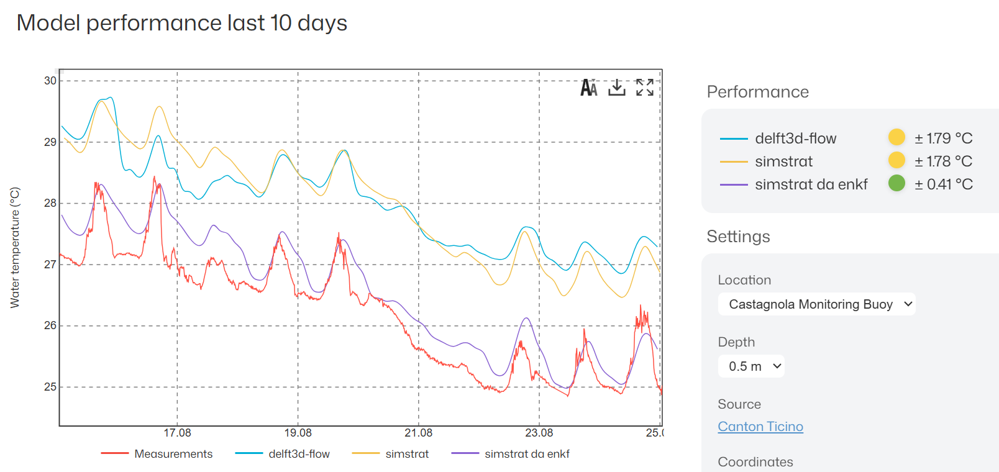

# Overview

*Last updated: October 2026. All results are for the 2025 calendar year unless stated otherwise.*

!!! abstract "In short"
    An ensemble Kalman filter corrects the Alplakes Simstrat models with in-situ temperature profiles. On seven lakes the operational setup lowers the hourly error by 25–50 %, at every depth on five of them. Most of the work went into the observation side; what is left is a model-spread problem: the ensemble is too narrow, especially at depth in the current setup.

Alplakes runs one-dimensional Simstrat simulations for many lakes in the alpine region. The models are calibrated, and they can still be significantly wrong from time to time (errors of up to 2 °C, sustained for weeks, are common). Meanwhile, moored thermistor chains and profilers sit in several of those same lakes reporting temperature every few minutes/hours.

Data assimilation is the right machinery for putting those two things in the same product. This workblog documents the module we built for it, in collaboration with the Canton of Ticino: the filters, the choices behind them, results across seven lakes, and, with equal weight, the things that still could need further work.

A large share of the effort described here went into making the filter *more fair*, and it did not make it *more accurate*.

## Reading paths

| If you want to… | Read |
|---|---|
| understand the project | this page → [Method](method.md) → [Results](results.md) |
| run it on a lake | [Tutorial](../tutorial.md) and [Run configuration](../configuration.md) |
| continue the research | [Open problems](open-problems.md) → [Experiments](experiments.md) → [Reference](reference.md) |
| look up a lake, a term or a branch | [Reference](reference.md) |

## What it looks like

{ width="880" .center }
/// figure-caption
Alplakes performance panel, Castagnola buoy, Lake Lugano, 0.5 m, end of August 2026: measurement (red), Delft3D-FLOW, Simstrat and the assimilated Simstrat run (BETA).
///

Figure 1 is the Alplakes performance panel for the Castagnola buoy on Lake Lugano at 0.5 m depth, data from Canton Ticino at the end of August 2026. The red line is the measurement. In summer both models sit well off it: Delft3D-FLOW about 1.8 °C, and Simstrat, the 1D model under focus here, also about 1.8 °C. The assimilated Simstrat run, sharing the same calibrated 1D model with the filter switched on, is at 0.41 °C error.

That panel is the BETA for Upper Lugano, and it is roughly what the finished product should look like. We extended (and calibrated) the EnKF filter to six further lakes with high-frequency in-situ data: Ägeri, Greifensee, Murten, Maggiore, Geneva and Hallwil.

## What the module provides

Any ensemble filter needs four ingredients:

- **An ensemble:** N perturbed copies of the model run in parallel, each with its own restart file. The spread between members is the model's uncertainty.
- **Observations:** measured values at known times, with a *stated* uncertainty that tells the filter how much to trust them.
- **A state vector:** what gets corrected at each update. For the 1D model in our experiments the temperature profile.
- **An update cycle:** the model runs until an observation arrives, the filter computes a correction for each member (or samples among the members), the corrected state is written back into the restart, and the model carries on until the next observation.

In practice that means we need a calibrated model, a real-time in-situ data source, an ensemble mechanism, and a filter. The module provides the last two:

1. A forcing-perturbation mechanism, which is how the ensemble is generated ([Method](method.md#spread)).
2. Two interchangeable engines: a customisable Python implementation and a parallel OpenDA setup, running a simple selection of the best-fitting member (Python), a particle filter (OpenDA), an Ensemble Kalman Filter (Python and OpenDA), and further versions thereof (OpenDA) ([Method](method.md#filters)).

It is currently designed for lakes with high-resolution in-situ profiles at sub-daily frequency.

## Status

The operational setup is the one we call `simplified_final`: native EnKF, 20 members, a fixed seasonal σ per lake, daily assimilation at a per-lake night hour. Its σ values are the ones in `args/run_enkf.json`, and every number in [Results](results.md) comes from it.

| Component | Status | Where |
|---|---|---|
| Forcing perturbation (AR(1) on wind U, V and solar radiation) | ✅ Operational | `master`: `src/assimilator/perturbate.py` |
| EnKF, native engine | ✅ Operational | `master`: `args/run_enkf.json` |
| EnKF, OpenDA engine | ⚙️ Optional (same result ~0.04 °C) | `master`: `args/run_openda.json` |
| OpenDA as a chain of restart cycles for future integration| ⚙️ Optional | `operational_openda-restart` |
| Seiche filtering, depth thinning, night-time assimilation hour | ✅ Operational | observation files on `master`; scripts on `feat/da-combi` and will be restructured for operational use|
| Seasonal fixed σ (`simplified_final`) | ✅ Operational | `args/run_enkf.json` |
| Vertical localization | (✅) Positive, potentially to be adopted | available in `feat/da-combi` |
| Adaptive σ | (✅) Positive, potentially to be adopted (needs limits) | `adaptive_sigma` branch |
| Parameter perturbation (at longer assimilation steps), 3D | (✅) Positive, potentially to be adopted | scripts available by request |
| Best-member selection, particle filter | ❌ Tested, not adopted (kept as reference) | `master` |
| Depth-resolved and rescaled σ | ❌ Tested, not adopted | worked on in `feat/da-combi` |
| Surface-only assimilation | ❌ Tested, not adopted | `feat/multi-station-obs` |
| Parameter sensitivity, joint estimation, deep mixing | 🔬 Open | scripts available by request |

✅ Operational · (✅) Positive, potentially to be adopted · ⚙️ Optional · ❌ Tested, not adopted · 🔬 Open

The Upper Lugano BETA shown above is the earlier version of the setup: it assimilates at noon, an hour we later found to not be an ideal choice ([Method](method.md#timing)).

## Headline numbers

- **−25 to −50 % hourly RMSE** on all seven lakes, pooled over depths and the year ([Results](results.md#enkf-gains)).
- **Every model level improves** on five of seven lakes.
- **The EnKF beats best-member selection and the particle filter on every lake**; selection is worse than no assimilation on three ([Results](results.md#which-filter)).
- **Native and OpenDA EnKF agree within 0.01–0.04 °C**, which validates the custom implementation.

## What we can say so far

**A fixed seasonal σ is ready and is a good operational solution:** 25 % or more improvement across seven lakes with high-resolution profiles, up to ~50 % in the best case.

**Forcing perturbations keep corrections small**, so the model is never shocked. That makes the scheme safe to run unattended.

**The large observation error also counteracts the over-confidence** that correlated, closely spaced observations would otherwise possibly generate.

**Near-surface seasonal bias is corrected reliably:** one of the major free-run failures.

**Profile data and seiche filtering each improve and allow improvements at intermediate depths in summer**; filtered profile data is central to a filter that works over the whole water column.

**Surface assimilation improves the upper layers**, but it cannot satisfactorily correct the whole profile in a 1D model; against low-resolution CTD data we show evidence that it can significantly damage the layers just below.

**Calibrating is useful for consistency, not so much for accuracy:** optimising calibration across seven lakes changed the RMSE by lttle overall. Estimating σ on the fly made every lake consistent but revealed a major problem related to internal feedback.

**The work described here is almost entirely on the observation side. What is left is a model-spread problem.**

**When does the filter perform best?** It performs best in the stratified season, and mostly inside the mixed layer. The gain front follows the mixed layer down through autumn ([Results](results.md#time-depth)), because the spread is made at the surface by wind and radiation and can only reach depth by mixing. So the filter is most useful exactly where the model has a seasonal surface-energy bias; less useful in winter, because the model errors are smaller; and worst at the summer thermocline, because that error is structural and difficult to overcome completely. The next real gain may come more from the model side and the accurate description of its structural uncertainities, rather than from the observations ([Open problems](open-problems.md)).
