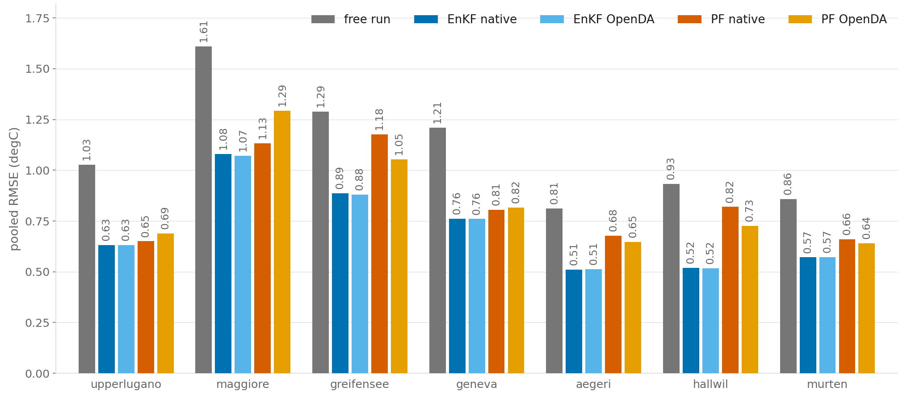
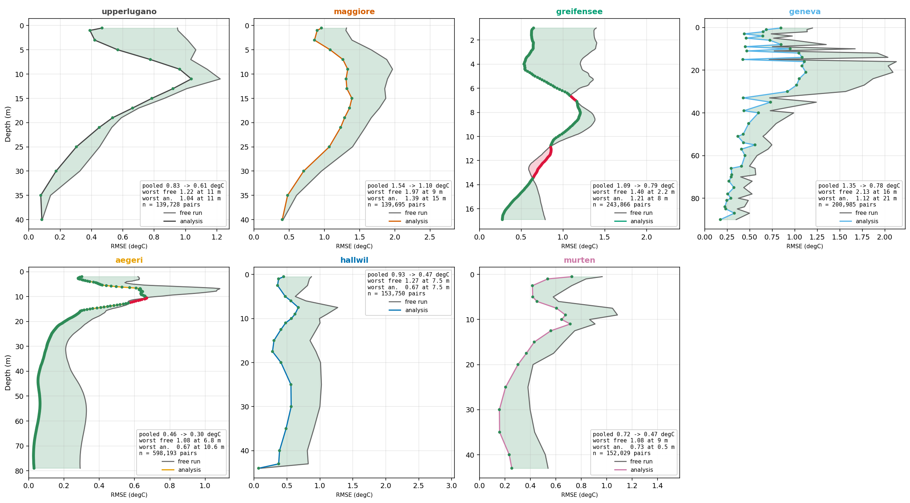
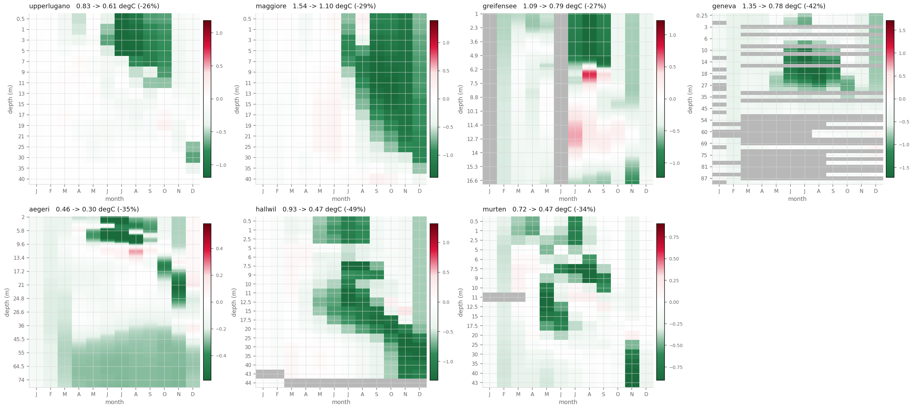
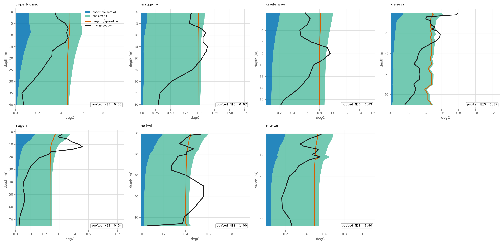
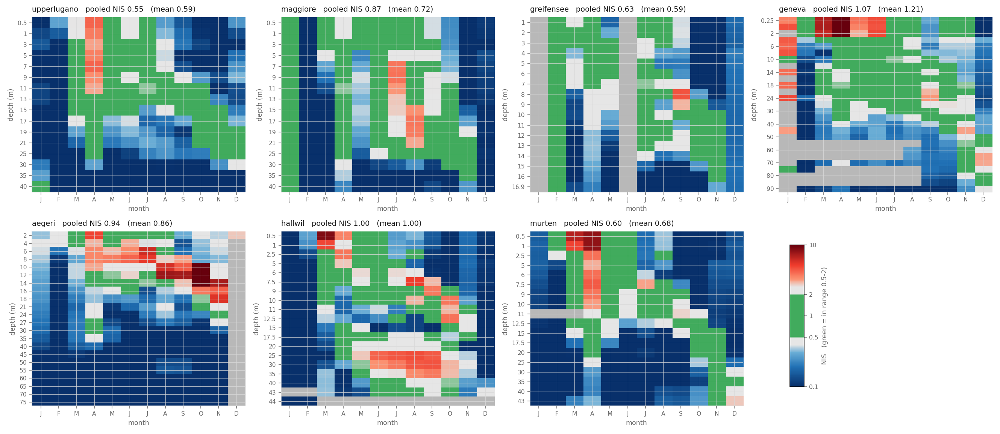
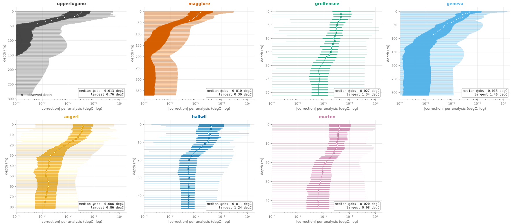

# Results

*Last updated: October 2026. Operational setup (`simplified_final`), 2025, 20 members; scored against hourly observations unless stated otherwise. Full run configuration in [Reference](reference.md#run-config).*

!!! abstract "In short"
    The EnKF wins on every lake, on both engines, and lowers the hourly RMSE by 26–51 %. The error peak at the thermocline or surface is lowered, not moved. The gain follows the mixed layer down through the year, because that is where the ensemble has spread. The filter is mostly over-cautious: σ fills almost the whole uncertainty budget, and the corrections are small.

## Which filter { #which-filter }

Pooled hourly over the year, all depths, RMSE in °C:

| Lake | free run | Selection | PF (OpenDA) | EnKF (OpenDA) | EnKF (native) |
|---|---|---|---|---|---|
| upperlugano | 0.83 | 0.69 | 0.75 | **0.61** | **0.61** |
| maggiore | 1.54 | 1.43 | 1.58 | 1.14 | **1.10** |
| greifensee | 1.09 | 1.67 | 1.25 | **0.78** | 0.79 |
| geneva | 1.35 | 0.94 | 0.90 | **0.77** | 0.78 |
| aegeri | 0.46 | 0.84 | 0.78 | **0.30** | **0.30** |
| hallwil | 0.93 | 0.87 | 0.72 | **0.45** | 0.47 |
| murten | 0.72 | 0.95 | 0.84 | **0.47** | **0.47** |

The same comparison restricted to the **top 10 m** (Figure 1):

{ width="800" .center }
/// figure-caption
RMSE by method and engine, top 10 m only, all seven lakes, 2025.
///

**The EnKF wins on every lake, on both engines, and not marginally.**

**Best-member selection is worse than not assimilating at all on three of seven lakes:** Greifensee (1.67 vs 1.09), Ägeri (0.84 vs 0.46), Murten (0.95 vs 0.72). If no member has the right profile, selecting one cannot help, and collapsing the choice to a single member appears to be worse than resampling more often than not. The two Ticino lakes are the exceptions where both selection and PF help.

**The native and OpenDA EnKF agree to within 0.01–0.04 °C on every lake.** The two configurations are built from identical inputs, identical perturbed forcings, identical warmup and identical observation series. The agreement validates our custom implementation.

**In the top 10 m the PF and selection perform much closer to the EnKF:** near the surface the perturbation acts directly, so the ensemble develops genuine spread and picking the best member can pick a modified enough profile. At depth the members are very close to each other, there is nothing to choose between, and the member selected for its surface fit arrives carrying its own deep profile. The PF's failure is a deep-profile failure, and it is the concrete cost of not building a per-depth correction.

## The EnKF gains { #enkf-gains }

| Lake | RMSE free | RMSE native | RMSE OpenDA | gain native | gain OpenDA | levels improved (native) | levels improved (OpenDA) |
|---|---|---|---|---|---|---|---|
| upperlugano | 0.83 | 0.61 | 0.61 | −26.3 % | −26.6 % | 16/16 | 16/16 |
| maggiore | 1.54 | 1.10 | 1.14 | −28.5 % | −26.2 % | 16/16 | 16/16 |
| greifensee | 1.09 | 0.79 | 0.78 | −27.1 % | −28.4 % | 130/160 | 136/160 |
| geneva | 1.35 | 0.78 | 0.77 | −42.5 % | −42.7 % | 44/44 | 44/44 |
| aegeri | 0.46 | 0.30 | 0.30 | −35.2 % | −34.3 % | 229/239 | 228/239 |
| hallwil | 0.93 | 0.47 | 0.45 | −49.2 % | −51.3 % | 19/19 | 19/19 |
| murten | 0.72 | 0.47 | 0.47 | −34.2 % | −34.2 % | 18/18 | 18/18 |

Pooled hourly over the year, for each depth, RMSE in °C (Figure 2):

{ width="880" .center }
/// figure-caption
RMSE against depth, free run (grey) vs analysis (colour), all seven lakes, 2025; green fill is the gain.
///

Free run in grey, analysis in colour, green fill is the gain.

**Every lake improves by at least 25%**. On five of seven lakes *every single model level* improves. The exceptions are Greifensee (around 7 m and between 11 and 13.5 m) and, more mildly, Ägeri (between 11 and 13 m). **Every lake's error peaks at the thermocline or at the surface, and the analysis lowers that peak without moving it.** The filter does not relocate the difficulty. Gains are often largest at the surface, and on some lakes the two curves converge in the deeper layers. Geneva's and Hallwil's spikes are data gaps.

## In time and depth { #time-depth }

{ width="880" .center }
/// figure-caption
RMSE change against the free run by depth and month, all seven lakes, 2025.
///

The same gain resolved by month (Figure 3). On Upper Lugano, Maggiore, Hallwil and Murten a **green staircase descends with depth through the year**, following the seasonal stratification.

The filter can only correct effectively where it has covariance, a model-observation gap, *and* where ensemble spread exists. Our spread is created at the surface, by wind and radiation, and reaches depth only by mixing. So the staircase traces the depth to which the ensemble is still dispersed effectively and where significant model error is present.

In winter the model errors are smaller, so corrections and gains are smaller too, and the panels fade toward white. Most of the significant red patches, where the analysis is worse than the free run, group around the thermocline in summer: it remains the challenging region.

## Is the filter honest? { #honest }

Accuracy is one question. Whether the filter's *stated* uncertainty matches the errors it actually sees is a different one.

### The uncertainty budget

{ width="880" .center }
/// figure-caption
Uncertainty budget by depth, all seven lakes, 2025: ensemble spread, observation error σ, model–observation gap and pooled target.
///

In Figure 4, blue is ensemble spread, green the assumed observation error, black the model–observation gap, orange the pooled target √(spread² + σ²), which is what the filter expects the gap to be.

**The observation error occupies essentially the whole uncertainty budget, and the spread collapses to near zero at depth for certain lakes**, a direct consequence of perturbing only surface forcing. This balance is what actually governs how large the corrections can be.

The model–observation gap (black) falls with depth on every lake, after a local maximum at intermediate depths. Where black and orange disagree the filter is not self-consistent: where black crosses above orange it is over-confident, where it sits below it is damped. Ägeri and Hallwil appear again as outlier cases. Overall, the setup tends to be over-cautious.

### In time and depth

{ width="880" .center }
/// figure-caption
Normalised innovation squared (NIS) by depth and month, all seven lakes, 2025.
///

The same comparison resolved in time (Figure 5), as the normalised innovation squared (NIS), `d² / (spread² + σ²)`: green is consistent, blue over-damped, red over-confident. **The map is mostly blue**: the filter is systematically too cautious and assumes more error than it actually sees. Observations in the deep column are particularly affected by the fixed-profile approximation and are trusted far too little. Where the filter *is* over-confident is spring, during the large model biases, and then sporadically in the deeper layers. Ägeri, with a very polarised profile in depth, and Hallwil are the odd cases.

### What the corrections look like

Figure 6 shows the absolute EnKF correction per analysis against depth for each lake, on a log scale: thick bars mark the typical range (interquartile range), thin lines the full range, dots the median at the observed depths, and the box gives the median and the largest single correction.

{ width="880" .center }
/// figure-caption
Absolute EnKF correction per analysis by depth, all seven lakes, 2025, log scale.
///

Because the spread is narrow and the observation error large in proportion, corrections are steered toward the observations only weakly: **median increments over column and time are 0.006–0.027 °C**, typically much smaller than the spread or the gap. The large increments (up to 0.3–1.4 °C) come from large innovations, and those live at the surface and, above all, where the model's thermocline and the observed one disagree. Below the stratification the correction magnitude decays down to a flat minimum, a structure that probably reflects the mixing activity in each lake.
